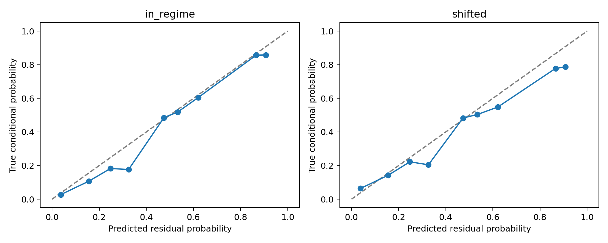

# DEV-053 review: null on adaptation

DEV-053B did not establish adaptive superiority over stationary Beta, a GRU or an HMM. The carried-versus-reset contrast does not survive adjustment and is not a positive headline. This retrospective review preserves the original frozen protocol, raw results, excluded-split record and published archive.

## Controls and uncertainty

Reset was applied during both training and evaluation. Its five separately trained checkpoints each received 256 updates and were reconstructed by the existing development audit. This was not a test-only intervention. However, the 20,000-draw paired stream/seed bootstrap gives the MTSK-minus-reset difference −0.007891/entity, with Bonferroni familywise 95% interval **[−0.019956,+0.000474]** for the three memory comparisons. Including the fourth registered HMM guard gives **[−0.020773,+0.000805]**. Both span zero. These are retrospective descriptive adjustments, not a new confirmatory acceptance rule.

The 6,400 optimizer updates were the total across 25 fits: **256 per fit**. Only first/final training loss was logged. Those data cannot establish a plateau. Training and testing share the same endpoint ranges; training contains Markov and triangular paths, while the old drift test introduces a sinusoid. This is a narrow one-dimensional family, not broad recurrent meta-learning. DEV-054 registers broader temporal families and four times the per-fit updates, with validation curves and a predeclared plateau diagnostic.

At drift/32, oracle headroom is only 0.007422/entity and about 44.7% of paired bootstrap denominators are nonpositive. **The current review suppresses its normalized ratio and interval.** MTSK costs 0.009922 more than stationary Beta, GRU-128 0.016172 more, and the mixture planner 0.027344 more. All absolute outcomes remain visible. DEV-054 prospectively requires headroom≥0.05/entity and fewer than 1% nonpositive denominator draws for a ratio; absolute cost remains primary for every cohort.

## Acquisition break-even

Each public observation costs 0.6 per productive entity. Below, optimistic oracle counts are ceil(acquisition / observed oracle saving), while MTSK counts use its observed saving versus Beta. These are hypothetical repeated-decision amortizations assuming the same saving persists. They are not measured deployment returns; drift invalidates that stationarity assumption particularly easily. No finite count is stated when the observed saving is nonpositive. Counts based on uncertain positive point estimates do not establish a break-even guarantee.

| Family | Observations | Acquisition/entity | Oracle saving/entity | Optimistic oracle decisions | MTSK cost minus Beta | Hypothetical MTSK decisions |
| --- | ---: | ---: | ---: | ---: | ---: | ---: |
| markov | 4 | 2.4 | 0.182812 | 14 | -0.004453 | 539 |
| markov | 8 | 4.8 | 0.105078 | 46 | +0.002891 | No positive saving |
| markov | 16 | 9.6 | 0.067969 | 142 | +0.029453 | No positive saving |
| markov | 32 | 19.2 | 0.329688 | 59 | -0.018438 | 1042 |
| drift | 4 | 2.4 | 0.060156 | 40 | +0.017109 | No positive saving |
| drift | 8 | 4.8 | 0.045313 | 106 | +0.014062 | No positive saving |
| drift | 16 | 9.6 | 0.110156 | 88 | -0.031406 | 306 |
| drift | 32 | 19.2 | 0.007422 | 2587 | +0.009922 | No positive saving |
| pooled | 4 | 2.4 | 0.121484 | 20 | +0.006328 | No positive saving |
| pooled | 8 | 4.8 | 0.075195 | 64 | +0.008477 | No positive saving |
| pooled | 16 | 9.6 | 0.089062 | 108 | -0.000977 | 9831 |
| pooled | 32 | 19.2 | 0.168555 | 114 | -0.004258 | 4510 |

The earlier 145-decision estimate correctly divides 19.2 by the headroom pooled across all five budgets (0.132734). Pairing the 32-observation expense with its own pooled endpoint headroom (0.168555) yields 114 optimistic oracle decisions. This accounting refinement does not rescue the benchmark's economics: the observed MTSK endpoint implies 4,510 decisions, with no validated persistent stream or reliable positive saving.

## Forecast quality and scope

Destructive forecast lesions establish policy dependence on the input. They do not validate the forecast, identify a memory mechanism, or establish useful calibration. The original per-decision proper-score excess is 0.0114 nats in regime and 0.0413 under shift, approximately 3.6× larger. The new ten-bin expected-calibration diagnostic compares predictions with true conditional probabilities on legal decision forecasts. Flattening those forecasts weights decisions with two legal scores twice as heavily as those with one, so its proper scores differ slightly from the original per-decision mean: 0.01116 and 0.04117 excess nats.

Expected calibration error is 0.03380 in regime and 0.03059 under shift. Coarse ECE does not worsen despite the worse shifted log loss; aggregation can conceal conditional forecast errors. These are descriptive bins on repeated forecasts, not independent sample intervals or evidence of improved shifted beliefs. Raw bin counts, means and proper scores are [preserved](../research/dev054/dev053-null-review.json).

The storage figures 4,452 and 208,908 are **bytes**, corresponding to 1,113 and 52,227 parameters. The 47× ratio describes two chosen configurations; it establishes no efficiency advantage. DEV-054 adds an actively used parameter-matched GRU and a GRU-plus-HMM hybrid, reporting the hybrid's extra filtering state/operations.

Only the MTSK kernel was exercised in DEV-053B. CDL, CASM and selective computation remain untested in this lane. The same-author audit shares model/generator code and establishes deterministic development replay and separate primitive accounting, not third-party replication.
