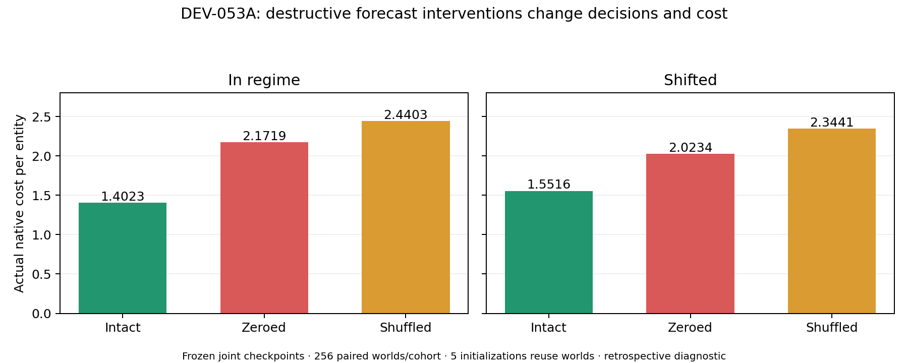

# DEV-053A — Review of the frozen DEV-052B recurrent world model

**Retrospective diagnostics completed. Forecasts affect actions; action parity does not establish accurate beliefs or a TAC-OSM mechanism result.** DEV-052B's learned component is a generic 32-dimensional per-entity GRU, with hand-coded addressing, action constraints and Bellman planning. It contains no MTSK writer, CDL router or CASM program induction. Its evidence concerns that recurrent world model and its bounded execution path, not the TAC-OSM thesis.

The original five-seed checkpoints, 512 held-out worlds, outcomes, acceptance rule and excluded-split record are unchanged. This review reuses previously exposed worlds and is not a new generalization or confirmation experiment. [Diagnostic registration](../research/dev053a/protocol.json) was committed before these checks.

## Does the model affect execution?

All original joint trajectories were first reproduced exactly. Then two destructive interventions were run closed loop through the same paid native simulator: replace current-fault and repair-success probabilities by zero, or permute whole learned forecast vectors among decision states. Shuffling uses a fixed seeded forecast-only pool; it is an intentionally invalid diagnostic policy, not an inference method.

| Intervention | In-regime cost/entity | Shifted cost/entity | In-regime faults, mean | Shifted faults, mean |
| --- | ---: | ---: | ---: | ---: |
| Intact joint model | 1.402344 | 1.551562 | 26.0 | 46.0 |
| Zeroed probabilities | 2.171875 | 2.023438 | 278.0 | 259.0 |
| Shuffled forecast rows | 2.440313 | 2.344063 | 185.6 | 178.6 |

Each cohort has 256 distinct worlds reused across five initializations. Zeroing changed native actions in every world; shuffling changed actions in 254–256 worlds per seed/cohort. A separate primitive-accounting process verified **7,680 policy/world executions and 37,650 paid native calls**. Thus forecasts are active inputs to decisions. This does not identify temporal memory as the cause of useful behavior, nor establish calibrated state estimates.

## What does exact action parity conceal?

The diagnostic evaluator independently reconstructed the true conditional fault probability from the actual public history using the simulator's probabilities. These probabilities never entered deployed model inputs. Expected Bernoulli log loss was scored on current-fault risk and the next legally applicable service risk; unavailable or already-used service heads are excluded. All head slots and the scoring mask remain logged. This mask clarifies the registration's service-head diagnostic without treating impossible past attempts as valid interventions.

| Intact joint forecasts | In regime | Shifted |
| --- | ---: | ---: |
| Expected log loss, nats | 0.372416 | 0.452784 |
| True-probability entropy, nats | 0.361060 | 0.411476 |
| Excess expected log loss, nats | 0.011356 | 0.041308 |
| Median top-two planning-value gap | 0.266333 | 0.258385 |
| Fraction of gaps above 0.1 | 0.771869 | 0.780901 |

No intact recorded decision with two legal alternatives had a gap below 0.01. Gaps are in the controller's calibrated planning objective, whose residual-risk multiplier may exceed the evaluator's fixed four-unit penalty. Forecast scores and gaps are descriptive over decision positions, including repeated seed/world states, not independent event-level inference. Wide margins make identical actions compatible with different forecasts. They do not prove the task has no relevant structure; destructive interventions clearly change behavior. The positive excess log loss directly refutes an inference of exact belief reconstruction from action parity alone.

## Oracle headroom and appropriate uncertainty

Under shift, observed estimated-planner cost was 1.5515625 versus 1.45703125 for the true-parameter reference, a gap of **0.09453125/entity**. Recurrent belief improved average cost by **0.0040234375/entity**, closing **4.2562%** of that gap. The in-regime oracle gap is zero, so its normalized closure is **undefined**, not zero or perfect.

Reanalysis uses 2,000 crossed paired bootstrap replicates. Each replicate resamples whole world clusters (stratified by the four shifted families), then resamples global model-initialization indices; within each comparison, controller, baseline and oracle use identical world draws. It preserves seed dependence across worlds and never turns five repetitions into 2,560 independent worlds.

For recurrent belief under shift:

* Paired cost difference: **−0.00402344/entity**, descriptive 95% interval **[−0.02640625, +0.01141016]**.
* Fraction of oracle gap closed: **4.26%**, interval **[−18.50%, +34.45%]**, conditional on positive resampled headroom. **0.6%** of denominator draws were nonpositive and are explicitly reported as undefined; this is not an unconditional ratio-confidence guarantee.
* Paired residual-fault difference: **−0.00546875/world**, interval **[−0.02111328, +0.0078125]**. No independent-Poisson shortcut is used.

The result remains inconclusive. These are retrospective development intervals, not multiplicity-adjusted confirmation. They supplement, rather than silently replace, the archived seed-averaged-world intervals. Fraction of oracle gap closed is the prospectively registered primary endpoint for DEV-053B.

The true-parameter reference's 64 shifted faults versus 46 for the estimated reference **does not demonstrate brittleness or overconfidence**. It achieved lower realized monetary cost under the specified failure penalty. Cost optimization permits a different cost/failure trade-off; superiority in reliability requires a separate reliability endpoint and guard.

## Evidence provenance and scope

The prior complete archive was SHA-256 verified, preserving its excluded initial split and correction record. The evidence commit's default Git object ID is SHA-1; two additional SHA-256 byte digests are recorded with explicit definitions rather than mislabeled as a native Git SHA-256 object ID:

* Evidence commit: `4b0b9d4089e63961a03782adcc6f5e541ff7c982`.
* SHA-256 of raw `git cat-file commit` payload: `36bbdb6171bb35b8701358b3618de43b6a4deb6ebfae5a2d7cc6aaf843d9a9c9`.
* SHA-256 of canonical `commit <length>\0<payload>` bytes: `3991da0284a50a89bda94688399863a244d3427aad8c78c20251d63e77e196f8`.
* Original archive SHA-256: `36567e08e1415b3cb58805207c3ddf81cafc972fe949525d1a062f26ddf4fc8e`.

[Machine-readable review](../research/dev053a/review-summary.json), [fault intervals and native replay accounting](../research/dev053a/supplement.json), and [original evidence index](../research/dev052b/evidence-index.json) preserve the details. All per-decision legal values, forecast vectors, conditional-probability references, interventions and native traces are in the new evidence archive. Same author, shared model/generator code and separate accounting process do not constitute third-party scientific review.

The next experiment deliberately tests adaptive repair-rate state against stationary and adaptive Bayesian controls at equal public observations. Its MTSK arm imports the actual repository kernel; it remains a mechanism-level experiment without learned CDL or CASM claims.
