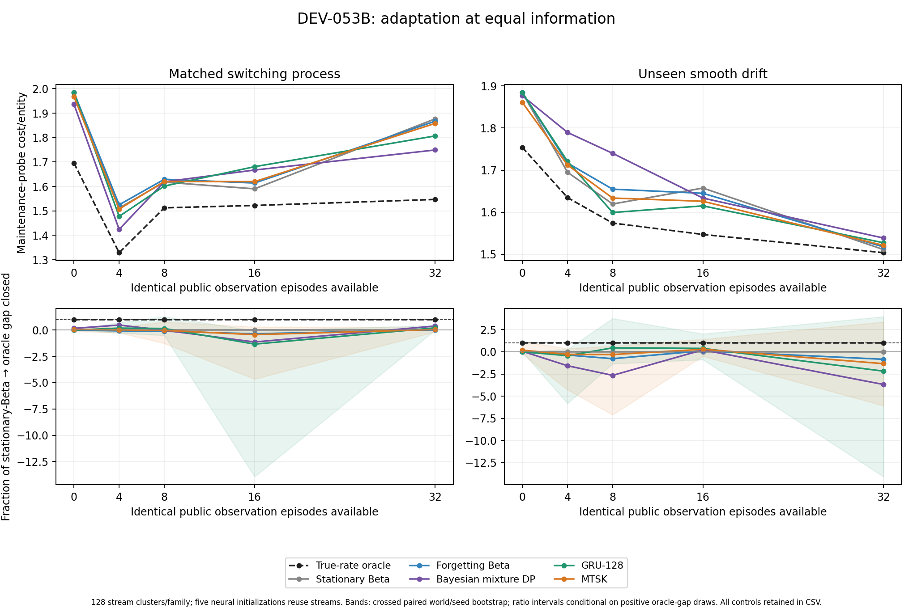
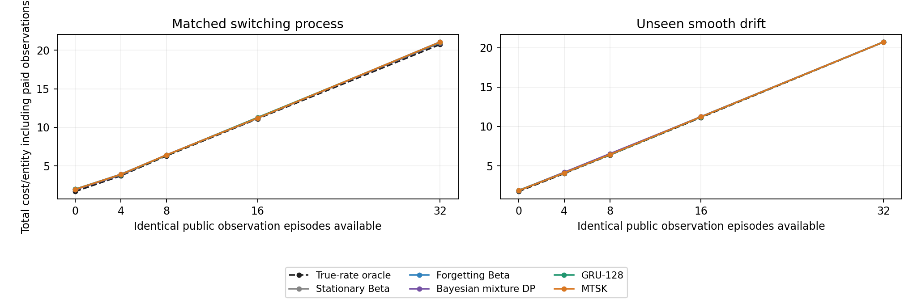

# DEV-053B — Equal-information recurrent adaptation under changing repair dynamics

**Completed and replay-audited development. No robust MTSK advantage established.** The actual repository MTSK kernel ran alongside generic recurrent and Bayesian controls. Public information, observation budgets and native action costs were paired. This is an MTSK component experiment, not a trained CDL/CASM system or proof of TAC-OSM's central thesis.

The primary pooled fraction of oracle cost gap closed was **1.58% for MTSK**, descriptive 95% interval **[−11.82%, +12.83%]**. GRU-128 closed **3.73% [−13.74%, +18.89%]** and HMM plug-in **8.83% [−6.11%, +21.88%]**. All span zero. MTSK failed the registered combined cost/reliability mechanism guard against every required reference/control.

* **25 fitted checkpoints**, five neural variants × five initializations; 256 updates per fit. No failed or dropped fits.
* **256 distinct final stream clusters**, each evaluated after 0/4/8/16/32 public observation episodes; repeated across initializations. These are not 6,400 independent model-seed/time samples.
* Every checkpoint tensor, calibration choice and deployed decision reconstructed. Separate primitive accounting replayed **39,680 probe executions / 278,615 native actions**, plus **65,536 calibration-fixture actions**. Shared author and generator/model code limit audit independence.
* **1,315 regression tests passed.** Research ran locally in the managed CPU environment. [Draft PR #213](https://github.com/FPC-effortless/TAC-OSM/pull/213) remains unmerged.
* [Protocol](../research/dev053b/protocol.json), [audited numerical record](../research/dev053b/audited-summary.json), [all curve data](../research/dev053b/learning-curves.csv), [compute accounting](../research/dev053b/resource-accounting.json), and [DEV-053A forecast review](DEV-053A-FORECAST-REVIEW.md).

## Registered primary result

Costs average equally across both families and all five observation counts, per productive entity. Neural rows average five initializations of identical streams. The stationary-Beta reference cost was **1.6947265625/entity**, the true-current-rate reference **1.5619921875/entity**, giving observed pooled headroom **0.132734375/entity**. Intervals use crossed paired stream/seed resampling; all pooled denominator draws were positive. They remain descriptive adaptive-development intervals, not confirmation.

| Controller | Cost/entity | Fraction of oracle gap closed | Descriptive 95% interval |
| --- | ---: | ---: | ---: |
| True-current-rate oracle | 1.561992 | 100.00% | [100.00%, 100.00%] |
| Fixed pooled prior | 1.700234 | -4.15% | [-20.20%, 7.93%] |
| Stationary Beta | 1.694727 | 0.00% | [0.00%, 0.00%] |
| Forgetting Beta | 1.703750 | -6.80% | [-23.35%, 4.80%] |
| HMM plug-in | 1.683008 | 8.83% | [-6.11%, 21.88%] |
| HMM mixture DP | 1.697383 | -2.00% | [-38.22%, 21.47%] |
| GRU-32 | 1.690703 | 3.03% | [-14.16%, 17.92%] |
| GRU-128 | 1.689773 | 3.73% | [-13.74%, 18.89%] |
| MTSK | 1.692625 | 1.58% | [-11.82%, 12.83%] |
| Frozen MTSK kernel | 1.703125 | -6.33% | [-21.22%, 5.19%] |
| Reset MTSK | 1.700516 | -4.36% | [-19.47%, 7.17%] |

The oracle and stationary rows are definitional endpoints, not superiority tests. Finite-sample oracle-gap closure is a comparative cost normalization, not a percentage of correctly learned world state. An oracle with current latent rates has privileged information; a well-specified posterior learner may still have irreducible uncertainty about the next regime.



The top panels show actual native maintenance cost against the identical observation budget; the bottom panels expose unstable normalized ratios rather than clipping them. Shaded bands are crossed paired stream/seed intervals for the neural examples. Different probe levels have independent native realizations on shared stream histories; nonmonotonic curves do not establish that more observations cause worse performance. Oracle/reference curves and clustered pairing control finite-cohort difficulty variation.

## Endpoint detail and headroom limits

At **32 public observations**, each family contains 128 distinct streams. Neural fault counts below are seed means on the same probe worlds. Lower cost with more residual faults is not called better reliability.

| Controller | Switching cost/entity | Switching faults, mean | Drift cost/entity | Drift faults, mean |
| --- | ---: | ---: | ---: | ---: |
| True-current-rate oracle | 1.546875 | 69.0 | 1.503906 | 47.0 |
| Fixed pooled prior | 1.885938 | 49.0 | 1.530469 | 36.0 |
| Stationary Beta | 1.876562 | 44.0 | 1.511328 | 29.0 |
| Forgetting Beta | 1.867188 | 43.0 | 1.517578 | 29.0 |
| HMM plug-in | 1.834766 | 41.0 | 1.512109 | 31.0 |
| HMM mixture DP | 1.749219 | 71.0 | 1.538672 | 63.0 |
| GRU-32 | 1.803594 | 43.4 | 1.524766 | 39.6 |
| GRU-128 | 1.806797 | 43.8 | 1.527500 | 38.8 |
| MTSK | 1.858125 | 40.0 | 1.521250 | 29.0 |
| Frozen MTSK kernel | 1.883125 | 46.6 | 1.532812 | 33.8 |
| Reset MTSK | 1.865234 | 39.0 | 1.527344 | 29.0 |

The switching endpoint has headroom **0.3296875/entity**; MTSK closes 5.59% of it, GRU-128 21.16%, and mixture DP 38.63%. The drift endpoint has only **0.007421875/entity** observed headroom. Around **44.7%** of its bootstrap denominator draws are nonpositive, so ratio intervals there are conditional, fragile, and unsuitable for a strong percentage claim. Raw costs, fault contrasts and invalid-draw rates remain in the numerical record. The generator and reference were not changed after this limitation appeared.

The mixture planner's 32-observation switching cost is lower than the plug-in controls, but it leaves 71 faults versus stationary Beta's 44. This is the specified economic trade-off, not evidence that true or richer Bayesian knowledge is brittle. Conversely, its continuous-drift model is misspecified and does not dominate pooled cost. A single control or endpoint cannot replace the registered pooled result and reliability guard.

### Component contrasts

| MTSK minus reference, cost/entity | Mean difference | Descriptive 95% interval | Full cost/fault guard |
| --- | ---: | ---: | --- |
| GRU-128 | +0.00285156 | [-0.01443301, +0.02089922] | Fail |
| HMM mixture DP | -0.00475781 | [-0.04075000, +0.03216484] | Fail |
| Frozen MTSK kernel | -0.01050000 | [-0.02523437, +0.00461836] | Fail |
| Reset MTSK | -0.00789062 | [-0.01719824, -0.00068672] | Fail |

Carried MTSK state has a modest negative cost contrast versus the reset control, with its unadjusted descriptive interval below zero. This is retained as a limited signal; the full per-initialization/family reliability guard still fails. Frozen-kernel and generic-GRU contrasts do not establish a robust learned-kernel benefit. These results neither prove memory useless nor promote MTSK as superior.

The neural and plug-in controls forecast three marginal rates and use a point-rate planner. The mixture reference additionally preserves joint regime/fault uncertainty during actions. Its difference from plug-in HMM includes a planning/representation change, not a clean memory comparison. Accurate marginal forecasts alone need not recover a sufficient predictive state for multi-action costs. Learning a richer joint predictive distribution, with convergence and strong matched controls on fresh worlds, remains an unexecuted follow-up—not a conclusion that a different writer must solve this task.

## Observation expense and compute



At 32 observations the shared prefix costs 38.4 per two-entity probe, adding **19.2/entity** to every curve. Thus a small improvement in probe cost does not make this one-probe calibration investment economical. These curves fix information budgets; they do not optimize when to buy observations or amortize calibration over a production workload. Fixture setup and verification overhead are assumed free, identically across arms.

Accepted matrix: **6,400 optimizer updates**, elapsed **877.02s**; audit **920.54s**. Including reconstruction and smoke, there were **12,830 registered research optimizer updates**, **1,117,938 native calls** including retrospective checks/replays, and **205,722 materialized probability-target cells**. Summed registered matrix/audit/review elapsed time was **31.78 process-minutes**, slightly above the approximate 30-minute compute tranche; the complete matrix was retained without outcome-based stopping or extra optimization. Summed elapsed time is not CPU-seconds; regression and interactive engineering checks are separately logged.

| Component | Retained FP32 state bytes | Parameter bytes |
| --- | ---: | ---: |
| GRU-32 | 128 | 15372 |
| GRU-128 | 512 | 208908 |
| MTSK | 512 | 4452 |
| Frozen MTSK kernel | 512 | 4452 |
| Reset MTSK | 512 | 4452 |

## Design and information boundary

The [protocol](../research/dev053b/protocol.json) was frozen at `a83e153` before implementation or training. Scientific implementation source is `f4af2cb`; reporting utilities were added later without changing the model or evaluation. There was no post-held-out tuning or early stopping. All five initialization seeds (7301–7305), all five neural variants, all six references, and unsuccessful controls are retained.

Training uses 512 task streams, validation 128, calibration 128, and final evaluation 128 matched-switching plus 128 unseen-drift streams. Each stream has 32 public observation episodes. Calibration and tests have separate seeds; smoke seeds are offset by 10,000,000 and unit tests use a distinct 8,531,xxx namespace. Each final stream is reused at five observation counts (0, 4, 8, 16, 32) and across neural initialization seeds. The statistical units are **256 stream clusters**, not the number of probe executions, time points, entities, or seed repetitions.

A public observation episode is a staged known-fault calibration fixture at a uniformly selected repair attempt. Native isolation and service are charged; the final native verifier reports whether that known fault was repaired. Its public contract makes the success bit observable. Neither current latent rates nor regime identifiers enter controller features. All methods receive the same attempt/success history. This trusted outcome channel and zero-cost fixture setup are explicit simplifying assumptions, not evidence that ordinary maintenance reveals hidden simulator state. Only training/calibration and evaluator targets receive the latent probability vectors.

The endpoint populations use the same fault prior (.5), noisy inspection accuracy (.85), three repair options, and shared native isolation constraint. Repair rates evolve across observation episodes, then remain fixed within a maintenance probe. Training mixes a switching two-regime process and triangular drift; evaluation contains fresh switching streams and unseen sinusoidal drift. Probes at different observation counts are separately generated and paired across controllers; their outcomes never update subsequent common histories. This is passive system identification, not learned exploratory data collection.

## Components and controls

The MTSK arm imports the repository's unmodified `SwiLAMTSK` kernel: fast/medium/slow retention, error-dependent expert responsibilities, and corrective delta writes. A learned five-field public-event encoder feeds a small configuration (8 model coordinates, 2 heads, 3 experts). Retained state comprises 96 matrix scalars, 24 responsibility scalars and an 8-scalar read: **128 FP32 scalars / 512 bytes**, excluding parameters, logs and Python allocation. GRU-128 matches this retained capacity; GRU-32 is the smaller generic reference. Parameter counts differ and are reported, so this is not a fully parameter- or FLOP-matched comparison.

The frozen-kernel control keeps kernel parameters at their common initialization while training encoder and forecast heads; its effective transition can still change as the encoder trains. The reset control uses the same MTSK initialization and exposure but clears matrix and responsibility state before every observation. It tests carried state within this configuration. Neither comparison establishes unique necessity of MTSK over all alternative recurrent systems.

Every neural arm receives 256 AdamW updates, batches of 32 streams, learning rate .001, weight decay .0001, gradient clip 1, full 33-position BPTT, and proper BCE against next-repair probability targets. There is no policy imitation objective. A fixed three-temperature grid is selected by calibration proper log loss; validation reports final scores without selecting updates. Weights remain frozen during final evaluation; the public history updates recurrent state.

The Bayesian controls use the same labeled training sources and public calibration histories: a pooled prior, stationary independent Beta estimation, discounted Beta estimation, HMM posterior means with plug-in planning, and a joint latent-regime/fault mixture planner. HMM endpoint rates are fitted from training-only Markov labels. Prior strength, forgetting factor and transition hazard have small registered calibration grids. No reference receives the current test regime, except the explicitly privileged true-rate oracle.

The mixture planner maintains and updates latent-regime/fault dependence after inspections and uncertain interventions. It carries the posterior between the two entities, but its lookahead is entity-local rather than globally optimal information planning across entities. The recurrent and plug-in controls hold their rate forecast fixed during a probe and update explicit fault belief from paid receipts. Both see the available public receipts; this difference in their use is a disclosed algorithmic limitation. Continuous drift deliberately misspecifies the two-state HMM. A win against stationary Beta alone would be weak evidence; the registered mechanism guard also compares adaptive mixture planning and GRU-128.

Entity addressing, symbolic action constraints, and Bellman planning are hand-coded. **No CDL router or CASM program discovery is trained.** This experiment bears on an MTSK component under this task, not on TAC-OSM's central relevance/computation scaling thesis or complete architecture.

## Endpoints and uncertainty

The primary endpoint is the fraction of observed oracle cost gap closed:

`(C_stationary_beta − C_model) / (C_stationary_beta − C_oracle)`.

The primary pooled ratio equally weights both families and all five observation counts. Per-level/family ratios and raw costs are also reported. Nonpositive oracle-gap denominators are marked undefined, never clipped or replaced. Bootstrap ratio intervals are conditional on positive denominator draws, with the invalid-draw rate disclosed; raw cost contrasts remain available when ratios are unstable.

Two thousand crossed paired bootstrap replicates resample whole stream clusters within family and globally resample initialization indices within each replicate. The same sampled worlds pair all references and the oracle; all observation counts stay inside their parent stream. This retains seed dependence across worlds. It does not treat the five repeats as independent new tasks or use an independent-Poisson model for fault differences. All intervals remain descriptive development evidence with only five initialization seeds.

Actual probe cost is `0.1*inspections + 0.2*isolations + 1.0*services + 4*residual faults`. The separate total-cost curve adds 1.2 per observed calibration episode before division by the two productive entities. Common observation generation is shared for experimental pairing, but deployment observation expense is not treated as free. Fixture creation and verification overhead are assumed zero; this is not an industrial ROI estimate.

The registered robust mechanism guard requires lower cost with a negative upper 95% paired cost contrast versus GRU-128 and adaptive mixture planning, no added residual faults or path/blocked violations in every initialization and family, and successful frozen/reset contrasts. A lower cost paired with more faults is not called a reliability win. The oracle minimizes the stated monetary objective; more faults at lower cost do not demonstrate brittleness.

## Audit, reproduction and limits

A separate process rebuilds all public observation histories and their native verifier receipts, reconstructs each checkpoint tensor and calibration choice, reproduces decisions, and replays every saved primitive action through a second cost/sensor accounting path. It shares its author, generator and model code with the experiment. This is deterministic reproduction and separate accounting, not third-party scientific review or a second independent simulator.

The pinned native Veritas commit is `b21d829b62d3cab2811e746267ca305e110ed004`; Python 3.12, PyTorch 2.14.1 CPU, NumPy 2.3.5, and Matplotlib 3.10.8 were used. Research ran locally in the managed CPU environment, not a GitHub Actions research job.

```bash
python scripts/run_adaptive_repair_dev053b.py --veritas-root /path/to/veritas --output results/dev053b
python scripts/audit_adaptive_repair_dev053b.py results/dev053b --veritas-root /path/to/veritas
python scripts/plot_research_dev053.py --adaptation results/dev053b
python scripts/demo_adaptive_repair_dev053b.py --evidence results/dev053b --arm mtsk --seed 7301 --family drift --level 32
```

The demo loads the checkpoint and updates actual recurrent state from only the requested public prefix. A single-stream MTSK demo matched the saved batched native actions and costs; forecasts agreed within 1e-6, allowing ordinary floating-point batch differences. Timings separately include fitting, native decision execution, and complete process elapsed time. They are not controlled FLOP/total-runtime superiority measurements. State size excludes observation logs, model parameters and interpreter overhead.

These are small synthetic tasks with idealized public calibration fixtures, fixed inspection accuracy, known entities, explicit execution contracts, and a bounded planner. They do not validate industrial safety, natural language competence, learned exploration, semantic retrieval, structural-program discovery, or generic TAC-OSM superiority. Outcomes of unsuccessful controls remain part of the scientific result.

Published [complete evidence index](https://github.com/FPC-effortless/TAC-OSM/releases/tag/dev053-recurrent-adaptation-evidence-2026-10-17) links the byte-verified archive. [Commit/object/archive SHA-256 provenance](../research/dev053b/evidence-index.json) records the exact evidence commit and byte definitions. GitHub evidence is deletable, not an immutable external archive.
