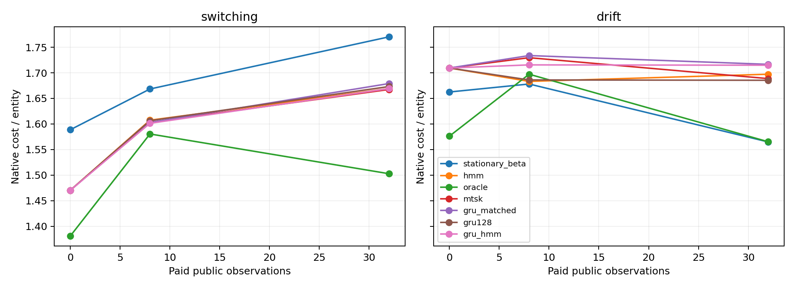
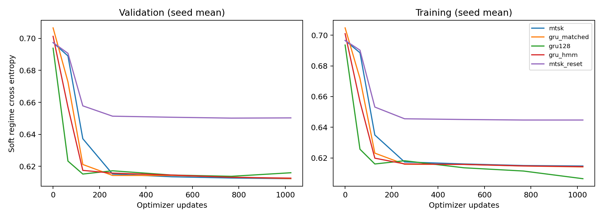
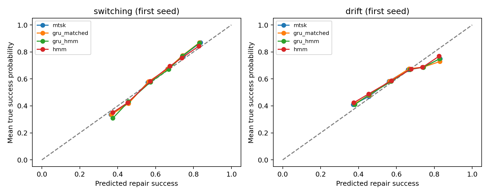

# DEV-054 — Common joint planning with matched belief encoders

**Completed registered development matrix and deterministic replay audit. No full TAC-OSM or commercial superiority claim.** The experiment tests learned regime beliefs with explicit joint regime–fault updates, addressing and entity-local Bellman planning. CDL, CASM, selective computation and learned physical transition rules are absent.

The preceding [DEV-053 null review](DEV-053-NULL-REVIEW.md) remains the interpretation of that experiment. Its reset contrast does not survive multiplicity adjustment. The original excluded split and immutable archives are preserved.

## Registered result

MTSK's pooled cost difference versus Beta is -0.010720/entity, with paired 95% interval [-0.057141,+0.034075]. Its residual-fault difference is +0.192274/world, interval [+0.163628,+0.221788]. Every adjusted mechanism comparison fails. This is a null on MTSK superiority, with a reliability regression against stationary Beta; the positive point estimate of normalized headroom closure is not an advantage claim.

Its secondary oracle-gap closure is 10.21%, with descriptive 95% interval [-54.19%,+44.39%]. Oracle 100% and Beta 0% are definitional reference endpoints.

The primary measure is absolute cost/entity difference versus stationary Beta, pooled equally over switching/drift and 0/8/32 public observations. Lower is better. Intervals resample whole stream clusters and initialization seeds, paired with controls. There are 256 distinct evaluation streams, reused across three model seeds and observation budgets; repeated seeds are not additional independent worlds. Intervals are descriptive development evidence, not confirmation.

| Controller | Native cost/entity | Cost minus Beta | Paired 95% interval | Oracle gap closed if eligible | Fault delta/world |
| --- | ---: | ---: | --- | --- | ---: |
| stationary_beta | 1.655469 | +0.000000 | [+0.000000, +0.000000] | 0.00% | +0.00000 |
| hmm | 1.639453 | -0.016016 | [-0.062697, +0.032554] | 15.25% | +0.21224 |
| oracle | 1.550456 | -0.105013 | [-0.159054, -0.051751] | 100.00% | +0.17578 |
| mtsk | 1.644748 | -0.010720 | [-0.057141, +0.034075] | 10.21% | +0.19227 |
| gru_matched | 1.651975 | -0.003494 | [-0.050456, +0.042254] | 3.33% | +0.19965 |
| gru128 | 1.638455 | -0.017014 | [-0.062435, +0.028191] | 16.20% | +0.18967 |
| gru_hmm | 1.646745 | -0.008724 | [-0.056123, +0.036719] | 8.31% | +0.19705 |
| mtsk_reset | 1.634180 | -0.021289 | [-0.060441, +0.018643] | 20.27% | +0.13585 |

Fractional normalization is secondary and is omitted unless observed headroom is at least 0.05/entity and fewer than 1% of denominator draws are nonpositive. All absolute results remain included. Full proper scores, paired fault intervals, bin counts, denominator diagnostics and each budget are in [summary.json](../research/dev054/summary.json) and [curves.csv](../research/dev054/curves.csv).



## Matched mechanism comparisons

Negative differences favor MTSK. These Bonferroni 95% familywise intervals adjust for the four registered comparisons. The reliability guard requires no additional faults or constraint violations in every initialization/family, as well as a negative adjusted upper cost bound. The registered full superiority condition also requires a measured deployment stream; that was not tested here.

| MTSK minus reference | Cost difference/entity | Four-comparison adjusted interval | Cost/reliability guard |
| --- | ---: | --- | --- |
| gru_matched | -0.007227 | [-0.020883, +0.004889] | False |
| gru128 | +0.006293 | [-0.014047, +0.028966] | False |
| gru_hmm | -0.001997 | [-0.016732, +0.012370] | False |
| mtsk_reset | +0.010569 | [-0.019858, +0.043263] | False |

## Endpoint reliability and economics

Each 32-observation prefix costs 19.2/entity, on top of productive-probe costs below. Break-even is a hypothetical ceiling(acquisition/observed saving) assuming that saving persists for subsequent decisions. Uncertainty is not removed by this division. No finite count is given for nonpositive savings. Probe outcomes do not feed later prefixes; this is not a measured adaptive production stream or a commercial value demonstration.

| Family | Controller | Cost/entity | Cost minus Beta | Faults, seed mean | Oracle headroom | Hypothetical break-even decisions |
| --- | --- | ---: | ---: | ---: | ---: | ---: |
| switching | stationary_beta | 1.770313 | +0.000000 | 40.00 | 0.267578 | No positive saving |
| switching | hmm | 1.669141 | -0.101172 | 60.00 | 0.267578 | 190 |
| switching | oracle | 1.502734 | -0.267578 | 64.00 | 0.267578 | 72 |
| switching | mtsk | 1.667448 | -0.102865 | 57.00 | 0.267578 | 187 |
| switching | gru_matched | 1.679036 | -0.091276 | 58.00 | 0.267578 | 211 |
| switching | gru128 | 1.673177 | -0.097135 | 56.00 | 0.267578 | 198 |
| switching | gru_hmm | 1.669141 | -0.101172 | 58.00 | 0.267578 | 190 |
| switching | mtsk_reset | 1.692057 | -0.078255 | 50.67 | 0.267578 | 246 |
| drift | stationary_beta | 1.564844 | +0.000000 | 26.00 | -0.000391 | No positive saving |
| drift | hmm | 1.697266 | +0.132422 | 69.00 | -0.000391 | No positive saving |
| drift | oracle | 1.565234 | +0.000391 | 44.00 | -0.000391 | No positive saving |
| drift | mtsk | 1.688672 | +0.123828 | 62.67 | -0.000391 | No positive saving |
| drift | gru_matched | 1.716536 | +0.151693 | 66.33 | -0.000391 | No positive saving |
| drift | gru128 | 1.685417 | +0.120573 | 63.00 | -0.000391 | No positive saving |
| drift | gru_hmm | 1.714844 | +0.150000 | 66.67 | -0.000391 | No positive saving |
| drift | mtsk_reset | 1.564323 | -0.000521 | 43.00 | -0.000391 | 36864 |

## Training and forecast diagnostics

All 15 fits received 1,024 updates, four times DEV-053B's 256 per fit. The same 512 training streams and privileged next-rate labels are available to neural training and baseline fitting. Training varies Markov hazards (.02/.08/.16/.32), sine/triangle paths and five periods. Evaluation uses fresh streams and interpolated hazards/periods within those numeric ranges. This is broader temporal training on a fixed one-dimensional endpoint manifold, not arbitrary task meta-learning.

A plateau flag requires absolute relative validation cross-entropy change ≤1% from update 768 to 1,024. It is a diagnostic, not a stopping or selection rule. A failure to plateau limits any architectural comparison; passing that check also does not prove global optimization.

| Encoder | Stored parameters | Parameter bytes | Ideal retained-state bytes | Plateau seeds | Validation improvement 768→1024 by seed |
| --- | ---: | ---: | ---: | ---: | --- |
| mtsk | 1104 | 4416 | 512 | 3/3 | -0.04%, +0.14%, +0.10% |
| gru_matched | 1100 | 4400 | 60 | 3/3 | +0.09%, +0.11%, +0.24% |
| gru128 | 52098 | 208392 | 512 | 3/3 | -0.31%, -0.44%, -0.34% |
| gru_hmm | 1104 | 4416 | 64 | 3/3 | +0.03%, +0.09%, +0.14% |
| mtsk_reset | 1104 | 4416 | 512 | 3/3 | -0.05%, +0.01%, -0.03% |



The small GRU and hybrid match MTSK's stored parameter count within 1%. MTSK's inherited `write_proj` is unused by the `_step` interface; this is disclosed below rather than padding other models. Matching stored parameters does not match active parameters, FLOPs or all tuning effort. GRU-128 is retained as a larger state-matched reference. The hybrid's HMM is additional to its neural parameters; its two-value NumPy posterior is 16 bytes in this implementation. Training metadata's 8-byte addend describes an ideal FP32 posterior, not actual NumPy storage. Python allocations, catalogue tables, planning workspace and logs are excluded from ideal recurrent-state counts.

| Encoder | Stored parameters | Parameters with gradient path | Median 32-event encoder ms |
| --- | ---: | ---: | ---: |
| mtsk | 1104 | 984 | 5.704 |
| gru_matched | 1100 | 1100 | 1.242 |
| gru128 | 52098 | 52098 | 1.076 |
| gru_hmm | 1104 | 1104 | 1.641 |
| mtsk_reset | 1104 | 984 | 5.093 |

These one-thread timings include hybrid filtering but exclude token conversion, planner/native execution and logging. They use the first seed and eight validation streams; they do not establish production speed, power or FLOP efficiency. Raw [profiling scope and unused tensors](../research/dev054/profile.json) are preserved.



Calibration bins compare predicted repair probabilities with simulator true probabilities. The plot illustrates the first seed; all seeds' bins/proper scores are retained. Expected log loss against current latent rates includes irreducible uncertainty and does not prove that an oracle-matching posterior is attainable from finite public evidence. Binned calibration can hide conditional errors. The continuous-drift family deliberately misspecifies the two-endpoint mixture class for all joint models.

## What is learned and what executes

MTSK/GRUs learn the next endpoint-mixture weight from public attempt/success history using soft regime cross entropy at all 33 positions. Endpoint rates are fitted once from privileged training labels and shared across neural/HMM arms. The GRU-plus-HMM also receives a posterior computed solely from the same public history. All use exactly the same joint planner and analytic service/inspection belief updates; the joint fault-state dependence is maintained by that explicit machinery. Beta and the privileged oracle use identical duplicate components to represent point-rate forecasts. This removes the old point-versus-mixture planning confound without claiming that neural memory discovered joint physics.

A restored checkpoint runs incrementally on a fresh stream through native Veritas:

```bash
OMP_NUM_THREADS=1 MKL_NUM_THREADS=1 python scripts/demo_joint_repair_dev054.py \
  --directory results/dev054 --output /tmp/dev054-live.json \
  --veritas-root /workspace/veritas
```

After downloading evidence, use its raw run as `--directory` if not extracted to `results/dev054`. The demo checks that incremental public-state updates reproduce batch forecasts and records native actions, value margins, costs and verification. It is the complete execution loop for this component model, not the complete TAC-OSM architecture. The unselected fresh demo leaves 1/2/0 residual faults at 0/8/32 observations: passing the checkpoint/incremental engineering check does not mean fault-free task success. These failed outcomes remain in the raw evidence.

## Integrity and replay

Registration commit `86b1cbc` precedes implementation `0940063` and training. Reporting additions do not alter the frozen protocol/model. Smoke seeds are offset 10,000,000; unit tests use 8541xxx; accepted streams use 5541001–5541005. There is no dropped seed or training cell. The [prior excluded-split record](../research/dev054/ORIGINAL-EXCLUDED-SPLIT-RECORD.md) and [provenance](../research/dev054/provenance.json) remain intact.

The same-author separate-process audit reconstructed **15 checkpoints**, replayed **13,824 probe executions / 62,453 primitive actions**, plus **57,344 fixture actions**. It shares model/generator code, so it establishes deterministic development reconstruction and separate native accounting, not independent scientific replication. Main runtime **892.95s**, audit **842.72s**, combined **28.93 process-minutes**; smoke, reporting, demo, regression and profiling are additional separately logged engineering work. Main+audit execute 30,720 optimizer updates. The complete 1,321-test regression suite passed. Native Veritas remains pinned and clean. Draft [PR #214](https://github.com/FPC-effortless/TAC-OSM/pull/214) remains unmerged.

The main/reconstruction tranche remained within the approximate 30-minute compute target.

The privileged monetary oracle also has +0.175781 additional faults/world versus Beta. Its cost headroom is therefore not a demonstrated reliability-feasible saving. The planner optimizes the stated monetary penalty, while the separate acceptance guard requires no additional faults. This objective/guard distinction must remain visible; it does not imply that true parameter knowledge is brittle.

Changing from the earlier study also changed data, exposure and evaluation budgets. Cross-study differences do not isolate the causal effect of joint planning. Here, continuous drift can violate the shared endpoint-mixture representation, and the monetary Bellman objective permits fault/cost trade-offs that fail the separate reliability guard. These are model/objective limitations to test, not post-hoc explanations established by this result.

## Published evidence

[Verified evidence release](https://github.com/FPC-effortless/TAC-OSM/releases/tag/dev054-joint-belief-evidence-2026-10-17) contains links to the unchanged raw archive and checksums at exact evidence commit `c2371f9d56e1f1435165a5a925a3669efdb7002c`. The archive was downloaded after publication and matched its original SHA-256 digest `ef8fb4c50e840f27842ee4a736d5119341769c255a203f7bc055afe745cf6321`; all 66 inner-file hashes passed. [Evidence index](../research/dev054/evidence-index.json) records archive size, original exclusion-record hash, and both commit-payload and canonical-object-byte SHA-256 digests. This publication adds integrity and access, not independent scientific validation.
