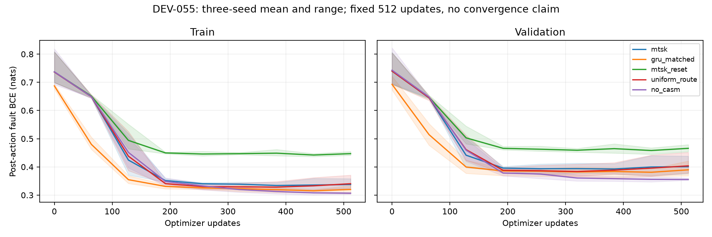

# DEV-055: learned dynamics, CDL-style routing and neural CASM execute; superiority fails

The complete public-history learned model trains, restores and drives a paid physical simulation loop. All 15 fits completed 512 updates. This establishes an executable development path; **it does not establish MTSK, relevance-routing or CASM superiority.** The registered reliability guard fails.

## Results

Costs are per two-machine, twenty-action world, including twelve paid randomized acquisition actions and residual-fault penalties at every step. Fault exposure is the sum of unresolved faults across ticks, not final residual faults or independent failures. There are 384 independent world clusters across two families, reused across three model initializations.

| Arm | Total stream cost/world | Fault exposure/world |
| --- | ---: | ---: |
| oracle | 52.7215 | 12.1406 |
| misspecified_independent | 56.1720 | 12.8411 |
| uniform_route | 56.5655 | 12.9089 |
| fitted_hmm | 56.8934 | 13.1094 |
| no_casm | 56.9227 | 13.0408 |
| mtsk | 57.1623 | 13.0451 |
| gru_matched | 57.7171 | 13.2543 |
| mtsk_reset | 60.2941 | 13.6241 |

| MTSK minus comparator | Paired cost difference | Interval |
| --- | ---: | --- |
| fitted_hmm | +0.2690 | [-0.9086, +1.4269] |
| gru_matched | -0.5548 | [-1.7453, +0.6003] |
| mtsk_reset | -3.1317 | [-4.7797, -1.5312] |
| uniform_route | +0.5968 | [-0.4519, +1.9448] |
| no_casm | +0.2396 | [-0.8643, +1.4373] |

The strongest observed conventional control is **misspecified_independent**, cost 56.1720. MTSK costs +0.9903 more (descriptive paired 95% interval [+0.0625, +2.0324]). This post-run comparator selection is disclosed; it does not replace the registered HMM endpoint.

The registered HMM oracle headroom is 2.0859/entity, interval [1.5914, 2.5776], with no increase in fault exposure for either family. This clears the registered floor. The oracle sees latent physical state and is a one-step reference, not an attainable public-information Bayes optimum.

Carried memory beats the retrained reset control on cost, with the adjusted interval excluding zero. That is a bounded memory-use result. Uniform routing and bypassing CASM have lower point costs than the full model; neither comparison establishes a benefit from the extra learned mechanism. No architecture or efficiency win follows.

## What is learned

- An event encoder and recurrent MTSK state, trained from public noisy sensors and paid inspection receipts.
- The existing `LearnedCDL` scorer over expert views and learned structural-workspace edges/messages.
- The existing sparse `ConditionalExecutor` operator bank, selector and halt head.
- Action-conditioned predictions of post-action fault marginals. Simulator-only fault labels supervise training; runtime cannot accept those labels.

The physics generator, two entity addresses, five-action grammar, costs and one-step argmin controller remain programmed. Public events are ten typed scalar features. This is CDL-style task-trained routing, not original CDL teacher distillation; neural conditional operators, not general symbolic CASM-S program discovery. The learned fault predictor is not a safety verifier. The model does not learn a long-horizon contingent planner or the value of inspections. Fixed-expert exhaustive scoring does not test indexed acquisition or C5.

## Training evidence



Every arm receives the same 512-update exposure and uses its final checkpoint. Shading is the minimum-to-maximum range of three seeds. Full per-fit curves are in [learning-curves.csv](../research/dev055/learning-curves.csv). No plateau or global-convergence claim is made.

| Arm | Used trainable parameters | Retained state bytes | Final validation BCE |
| --- | ---: | ---: | ---: |
| mtsk | 2918 | 480 | 0.40074 |
| gru_matched | 2936 | 32 | 0.38965 |
| mtsk_reset | 2918 | 480 | 0.46585 |
| uniform_route | 2773 | 480 | 0.40372 |
| no_casm | 1386 | 480 | 0.35545 |

Parameter matching counts used trainable parameters, without padding; inherited unused MTSK paths are frozen and their stored bytes are separately reported. Reset and bypass arms are mechanism ablations, not parameter-matched architecture controls. Timings include development-environment contention and are not production benchmarks. Frozen raw per-world `work` diagnostics used batch-total integer division, rounding down uneven early halting. Original bytes remain preserved. The audit reports exact trace-counted calls and diagnostic mismatches; the runner is corrected for future runs. Predictions, actions, costs, faults and registered acceptance outcomes are unaffected.

## Verification and reproduction

Training source: `8b07745b12cfb353ca8f8e7212a7eab8571ea151`. Protocol registration: `5067a82`. Main elapsed time: 215.27 seconds. The separate [audit record](../research/dev055/audit.json) is authoritative for restored checkpoint, physical replay and native Veritas counts. Native effect tables encode the recorded newly authored synthetic trajectories. Veritas checks execution, receipts, accounting and final state; shared physics limits independence. Failed final-world outcomes are retained. No real-world outcome verification follows.

```bash
uv venv .venv
uv pip install --python .venv/bin/python torch==2.14.1+cpu --index-url https://download.pytorch.org/whl/cpu
uv pip install --python .venv/bin/python numpy==2.5.4 pytest==9.1.1 matplotlib==3.11.2
# Optional native replay: install the pinned Veritas checkout as described below.
.venv/bin/python scripts/run_learned_stack_dev055.py --output results/dev055-reproduction
.venv/bin/python scripts/audit_learned_stack_dev055.py --directory results/dev055-reproduction --output results/dev055-reproduction-audit.json --veritas-root /path/to/veritas
.venv/bin/python scripts/demo_learned_stack_dev055.py --checkpoint results/dev055-reproduction/7551-mtsk.pt --events research/dev055/example-public-events.jsonl
```

Use a clean committed worktree for the registered full run. Check out Veritas `b21d829b62d3cab2811e746267ca305e110ed004` and install it with `uv pip install --python .venv/bin/python -e /path/to/veritas`. The input example and all tests use disjoint development namespaces. The raw evidence manifest covers all fifteen checkpoints, complete reports, controls and fitted filters.

## Next bounded decisions

DEV-056 is the registered memory-novelty deadline: matched GRU superiority with reliability and adequate oracle headroom must be established, or the memory-novelty claim is retired for this program. Inadequate headroom cannot be used to claim success or postpone the deadline indefinitely. DEV-057 must return to the distinct C5 questions: indexed acquisition, equal-bits scalar state and hash baselines, with one-time index construction, reads, writes, addressing and verification charged. Those experiments have not been run here. All findings remain development evidence.
