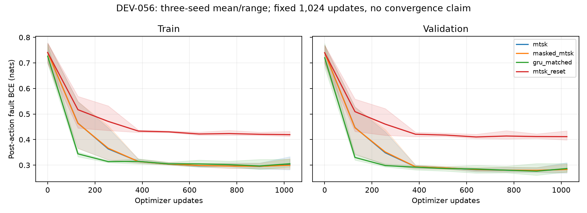

# DEV-056: deadline reached; retire MTSK-specific superiority pursuit

The complete twelve-fit matrix finished. The registered decision is **RETIRE_MEMORY_NOVELTY_PURSUIT**. This decision is limited to this research program; it does not assert that MTSK can never help any task, and it does not retire TAC-OSM, learned world models or selective computation.

## Cost and reliability

All costs are per two-entity world over 24 actions, including sixteen paid randomized acquisition actions and eight productive actions. Fault exposure accumulates unresolved faults over ticks; final faults are unresolved machines at the final tick. These quantities are different. The 384 independent worlds are shared across initialization seeds; seed-world rows are not independent samples.

| Arm | Total cost/world | Fault exposure/world | Final faults/world |
| --- | ---: | ---: | ---: |
| misspecified_independent | 69.5182 | 15.8620 | 0.2500 |
| fitted_hmm | 69.9104 | 16.0729 | 0.3021 |
| public_oracle | 69.9552 | 16.0755 | 0.2969 |
| gru_matched | 70.4492 | 16.0625 | 0.2717 |
| masked_mtsk | 71.3049 | 16.2856 | 0.3177 |
| mtsk | 71.4036 | 16.3134 | 0.3238 |
| mtsk_reset | 73.9754 | 16.8542 | 0.4418 |

The adaptive comparator **fitted_hmm** was selected on a separate 128-world validation stream before held-out outcomes were generated. Both conventional controls remain reported. The fitted HMM also uses privileged training regime labels; the neural GRU/MTSK comparisons have matched supervision.

| Variant minus comparator | Cost difference | Simultaneous interval | Fault guard |
| --- | ---: | --- | --- |
| mtsk − gru_matched | +0.9544 | [-0.4950, +2.3523] | False |
| mtsk − fitted_hmm | +1.4932 | [-0.2814, +3.2486] | False |
| masked_mtsk − gru_matched | +0.8556 | [-0.5226, +2.3364] | False |
| masked_mtsk − fitted_hmm | +1.3944 | [-0.3291, +3.2537] | False |

Intervals use the preregistered four-comparison Bonferroni familywise95% procedure, with paired world-cluster and global initialization-seed resampling. [Every seed/hazard fault-guard cell](../research/dev056/reliability-cells.json) is retained. No bad cell or variant was dropped.

## Public-information headroom

The oracle receives only public sensor/inspection receipts and the declared hazard. It filters the joint eight-state distribution using known probability laws, rather than reading sampled physical faults or the hidden regime. Its update matches explicit eight-state Bayes enumeration in a disjoint test. It remains a one-step known-model policy, not a long-horizon Bayes optimum.

| Reference minus public oracle | Saving/entity | Paired95% interval | Reliability feasible | Adequate |
| --- | ---: | --- | --- | --- |
| gru_matched | 0.2470 | [-0.2789, 0.7826] | False | False |
| fitted_hmm | -0.0224 | [-0.2896, 0.2373] | False | False |

Adequate headroom requires a saving of at least0.1/entity, a positive lower interval, and no increased aggregate fault exposure or final faults for either hazard versus both comparators. The complete headroom gate is **False**. Insufficient headroom would limit the benchmark but cannot postpone the registered retirement deadline.

## A separately identified mask

This study implements a genuine write mask. When closed, both memory and recurrent responsibilities are held exactly, including decay; inference skips the backend for closed samples. A forced-open mask matches unmasked recurrence with shared weights. The gate has a hard forward choice and biased straight-through training derivative. This is distinct from CDL relevance or CASM operator routing.

| Initialization | Potential writes | Backend updates | Skipped | Gate weight change L1 |
| --- | ---: | ---: | ---: | ---: |
| 7561 | 9216 | 9216 | 0 | 2.8469 |
| 7562 | 9216 | 9216 | 0 | 2.0826 |
| 7563 | 9216 | 9216 | 0 | 2.6450 |

**The trained gates skipped zero backend updates in this evaluation.** The mask mechanism is implemented and checked, but this recipe did not learn selective writing. No masked-memory sparsity or efficiency result follows.

## Exposure and retained state



All fits use final checkpoints after1,024 updates, with the same public histories, factual outcome supervision and structural decoder. Curves include each fit; shading is the three-seed range, not a confidence interval. No plateau/global-convergence claim.

| Arm | Used trainable parameters | Retained state bytes | Final validation BCE |
| --- | ---: | ---: | ---: |
| mtsk | 2926 | 480 | 0.28379 |
| masked_mtsk | 2935 | 480 | 0.28300 |
| gru_matched | 2944 | 32 | 0.28670 |
| mtsk_reset | 2926 | 480 | 0.41147 |

Unused inherited paths are frozen. Matching counts actual used trainable parameters, within2% for both MTSK variants versus the GRU, without padding. Parameter/state accounting and training timings are diagnostics; no speed or storage superiority is asserted.

## Provenance and reproduction

Registration `3f39f8d`; main training source `5890be420e02c22218e24e292e64d75a21fa8f64`. Main elapsed 390.37 seconds. The protocol transparently records that implementation drafts/disjoint unit tests preceded registration after an initial shell failure; no main numerical outcomes preceded registration. This is preregistered development evidence, not confirmation.

The [audit](../research/dev056/audit.json) restores every checkpoint and independently reruns decisions in another process, then replays complete trajectories through pinned native Veritas with 24-action budgets. Same author, shared generator and recorded effect tables limit independence. Unrepaired final outcomes are preserved. Native replay is not real-world verification.

Download [all checkpoints and raw evidence](../research/dev056/evidence.tar.gz), check [SHA256/provenance](../research/dev056/evidence-index.json), then extract into `results/`.

```bash
mkdir -p results
tar -xzf research/dev056/evidence.tar.gz -C results
.venv/bin/python scripts/audit_public_memory_dev056.py --directory results/dev056-main --output results/dev056-replay-audit.json --veritas-root /path/to/pinned/veritas
.venv/bin/python scripts/demo_public_memory_dev056.py --checkpoint results/dev056-main/7561-gru_matched.pt --events research/dev056/example-public-events.jsonl
# Fresh registered reproduction requires a clean committed worktree:
.venv/bin/python scripts/run_public_memory_dev056.py --output results/dev056-reproduction
```

Retirement ends MTSK-specific superiority tuning in this lane. Reuse of the implemented backend as a non-superior research component is still allowed. The next architectural question is acquisition and useful selective computation; [DEV-057](DEV-057-RESULTS.md) establishes reference costs, not learned superiority.
