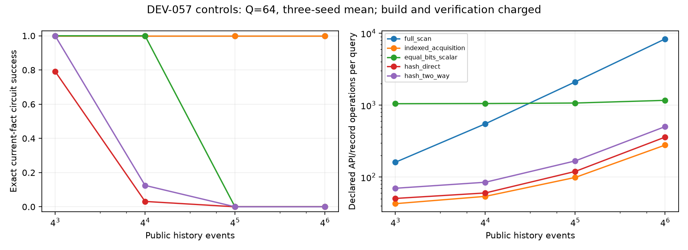

# DEV-057: acquisition references reproduced; learned C5 remains open

**All180 registered cells reproduce.** Full scan and hand-coded indexed acquisition preserve exact answers across every cell. Fixed-capacity scalar/hash stores do not preserve arbitrary history. These are baseline and instrument results; there is no learned challenger and no new TAC-OSM selective-computation superiority claim.

Each query requests the latest facts for eight distinct public entity keys, then executes seven public XOR nodes. Four independently shuffled write epochs create overwritten records. Missing inputs force abstention, rather than counting a lucky XOR guess as success. Keys and the circuit are supplied; there is no learned relevance relation or symbolic program discovery.

## Capability and work



At64 queries per built history, exact success averaged over three seeds is:

| Arm | H64 | H256 | H1024 | H4096 |
| --- | ---: | ---: | ---: | ---: |
| full_scan | 1.0000 | 1.0000 | 1.0000 | 1.0000 |
| indexed_acquisition | 1.0000 | 1.0000 | 1.0000 | 1.0000 |
| equal_bits_scalar | 1.0000 | 1.0000 | 0.0000 | 0.0000 |
| hash_direct | 0.7917 | 0.0312 | 0.0000 | 0.0000 |
| hash_two_way | 1.0000 | 0.1250 | 0.0000 | 0.0000 |

The index reads all H incoming writes during construction and performs eight logical record reads per query. Full scan reads H records per query. These record counts are distinct from address operations, maintenance writes, circuit operations and verification. All are reported, including build cost amortized over Q=1,8,64. Query prefixes share data and are not independent replications.

The scalar reference performs eight independent scans of its64 records; the full-history reference batches the eight requested keys in one scan. A batched scalar implementation could reduce its lookup probes from512 to64 per query. Reported costs are for these explicit implementations, not optimal scalar lower bounds. Any future learned efficiency claim must include the stronger batched scalar control.

Scalar/direct-hash/two-way-hash state is exactly64 records ×3int32 =768bytes/6144bits per arm, including key/tick/bit and validity. There is no retained external history or lookup table for these three arms. Equal-bits means equal among these controls; it is **not** a matched-state comparison against MTSK or a learned model. Hash collisions are detected as missing keys.

## Storage and build trade-off

At H4096 and Q64, the first registered seed gives:

| Arm | Payload bytes | Resident container estimate | Declared operations/query |
| --- | ---: | ---: | ---: |
| full_scan | 49152 | 49280 | 8351.00 |
| indexed_acquisition | 12288 | 151696 | 279.00 |
| equal_bits_scalar | 768 | 896 | 1168.00 |
| hash_direct | 768 | 896 | 360.00 |
| hash_two_way | 768 | 896 | 504.00 |

The unbounded index is not capacity-matched to the finite controls. Its payload holds latest records, but Python mapping overhead makes its resident container estimate larger than the full history array in this cell. Resident figures are recursive container estimates, not RSS or full allocator accounting. Work units are declared API/record operations, not CPU instructions; Python dictionary internals are explicitly unmeasured. Wall times are descriptive and do not prove an asymptotic or production-speed advantage. Verification reads synthetic gold only in the evaluator and is counted separately; it is not deployable ground-truth verification.

## Audit and next falsifier

Training-free source `cec661ec7364266259eee9d9f7569cfdc382ac95`; registration `3f39f8d`. The separate-process [audit](../research/dev057/audit.json) regenerated every exact answer, capacity and work count, excluding timing. Adversarial tests cover collisions, stale writes, absent keys and hidden extra state. [All cells](../research/dev057/cells.csv) and [complete evidence](../research/dev057/evidence.tar.gz) are preserved; see [archive SHA256](../research/dev057/evidence-index.json).

```bash
mkdir -p results
tar -xzf research/dev057/evidence.tar.gz -C results
.venv/bin/python scripts/run_acquisition_controls_dev057.py --output results/dev057-main --audit
```

A future learned-acquisition experiment must add nontrivial relevance, match total state/index storage, charge every write/build/address/verification operation and evaluate actual learned CASM execution under equal answer quality. Public-key lookup controls do not satisfy those conditions. C5 remains open.
