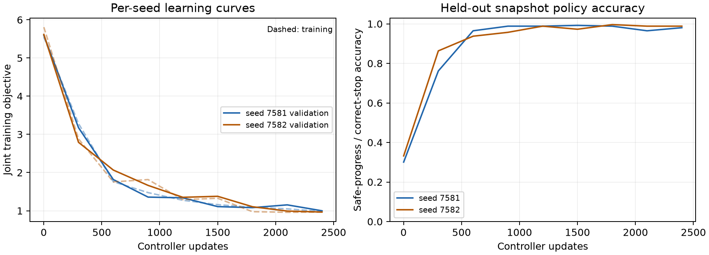

# DEV-058: an autonomous learned control path

DEV-058 replaces the remaining task-specific deployment decisions with trained
neural modules. The exported agent observes public events, learns which events
to admit and where to write them, retrieves relevant evidence, composes neural
CASM operators, predicts action consequences, proposes a second imagined action,
predicts completion and selects the actual next action, including stop and
correction. There is no analytic cost argmin, entity-to-slot dictionary,
handwritten transition model, repair controller, retry rule or completion
threshold in the deployed agent.

This is a **working teacher-trained agent for a bounded synthetic task**. It is
not the complete original TAC-OSM theoretical architecture, unsupervised program
discovery, C5 scaling, MTSK superiority or a real-world maintenance product.
MTSK-specific superiority pursuit remains retired.

## Autonomous results

The functional target was registered in [the protocol](../research/dev058/protocol.json)
before implementation. Its amendment, also before the main run, explicitly
allows training-only graph supervision and makes all changed states public in
action receipts. Source `e6b68098a13531476ddd52a24860736dc7e66d72` was committed
before the main outcomes. The first registered recipe passed validation at both
seeds; the two alternative recipes were not needed. Test worlds were opened
only after that selection. The default export uses seed 7581, the first
preregistered seed; it was not selected by comparing final-test scores.

| Entities | Public history | Seed 7581 successes / 64 | Seed 7582 successes / 64 |
|---|---:|---:|---:|
| 2 | 32 | 64 | 63 |
| 2 | 96 | 64 | 64 |
| 2 | 128 | 64 | 64 |
| 4 | 32 | 64 | 60 |
| 4 | 96 | 64 | 63 |
| 4 | 128 | 64 | 59 |
| 6 | 32 | 64 | 61 |
| 6 | 96 | 64 | 64 |
| 6 | 128 | 64 | 62 |
| **All** | | **576/576 (100%)** | **560/576 (97.22%)** |

Every cell passes the registered threshold: at least 90% completion at N=2/4
and 80% at N=6. Completion requires both no residual faults **and the learned
policy choosing stop**. These are 576 distinct test worlds, paired across
initializations, not 1,152 independently generated environments. Seeing zero
failures at one seed is not a guarantee of zero failure probability.

Seed 7582's 16 failed completions all exhausted the external action budget
without stopping. Fifteen ended physically repaired; one retained two faults.
They remain in the archive. Seed 7581 has zero such outcomes. The policies
encountered 86 and 96 failed repair attempts respectively in the test rollouts;
subsequent action choices still came from the checkpoint, not a retry routine.

| Average experimental cost / world | Seed 7581 | Seed 7582 |
|---|---:|---:|
| Actions plus terminal fault charge | 1.30938 | 1.47986 |
| Observations | 0.87516 | 0.87688 |
| Admitted writes | 0.15813 | 0.16156 |
| Total | 2.34266 | 2.51830 |

All initial history is read and charged. Admission saves writes after seeing
records; this is not indexed information acquisition. Costs are synthetic
units, not money. There is no competitive-baseline superiority or commercial
break-even claim in this experiment.

## What is learned, and what remains programmed

| Deployment component | DEV-058 implementation |
|---|---|
| Public event encoding | Trained neural value encoder |
| Admission / retention | Trained binary neural admission gate; no label lookup |
| Write address | Trained neural address logits over 32 generic slots; no entity-slot mapping or programmed free-slot search |
| Persistent state | Only latent memory and occupancy tensors; no raw-history cache or fault dictionary |
| CDL-style relevance | Learned content queries/keys and top-k reads from generic retained memories |
| Structural dependencies | Learned candidate graph attention, supervised only during training |
| CASM computation | Trained selector, three neural operators and learned halting with at most two composition depths |
| Dynamics and imagination | Trained action-conditioned latent transitions and learned second-action proposal; two imagined transitions |
| Outcome / cost / completion estimates | Neural heads trained from teacher/simulator examples |
| Actual action, correction and stop | Trained policy logits; argmax over all public real candidates |

The actual policy consumes the learned imagined states and learned completion
and cost signals. It has no direct action-descriptor shortcut around dynamics.
All real actions remain available, including harmful unnecessary repairs;
masking removes tensor padding only. Candidate order and opaque public entity
codes vary across worlds. The public JSON runtime does not know action names,
entity relationships or simulator laws.

Necessary programmed infrastructure is explicit: tensor operations and neural
architecture, finite memory/top-k/depth/rollout budgets, a threshold on learned
admission/halting probabilities, argmax on trained logits, serialization and
public API transport. The architecture fixes what operations a neural CASM
operator can express; it does not discover an arbitrary symbolic language.
The learned address allocator imitates generic free-slot labels during
pretraining. It is not evidence of capacity-independent replacement or long-term
memory management. The environment, training teacher, rewards and external
scoring verifier have programmed rules and are **excluded from deployment**.
A learned completion estimate is fallible; it does not replace external ground
truth with a neural claim of success.

The task itself exposes exact initial status and coupling records, interleaved
with noise, and exact receipts for every entity changed by an action. It is fully
observed through public history. There are only two, four or six entities,
disjoint parent-child relations, three action types, eight possible opaque
identity codes and a fixed feature schema. Do not generalize these outcomes to
partially observed industrial systems, arbitrary identities, unlimited history
or an extensible tool vocabulary. Original CDL distillation, general CASM-S
symbolic discovery and C5 scaling remain separate open requirements.

## Training and the autoresearch method

This adapts [Karpathy's autoresearch](https://github.com/karpathy/autoresearch)
idea of a source-controlled, bounded train/evaluate/retain loop. It is a CPU
PyTorch task-specific harness, not a run of upstream's language-model
`train.py`, five-minute GPU objective or an indefinite overnight search.
The registered recipe list, validation-only selection and unchanged final test
replace upstream's language-model metric. The first recipe was retained after
both validation runs; there was no final-test-driven tuning or heuristic rescue.

Admission and addressing receive 1,200 supervised pretraining updates and are
then frozen **trained weights**. The other components receive 2,400 joint
updates per seed from 8,192 training snapshots, with a separate 512-snapshot
validation set. The teacher supplies safe-progress actions, counterfactual
transitions, completion and graph/read targets during training. This learns to
imitate structured expertise; it does not discover maintenance laws from
reward alone. Offline training may cache public records retained by the neural
writer to re-encode them efficiently. Deployment has no such raw-record cache;
a test checks equality with incremental latent-memory updates.

Both writer fits reach 100% gate and address accuracy on their final synthetic
pretraining batches. Training loss components, validation curves, first-step
gradients and parameter changes are retained per seed. The audit additionally
records every tensor's change from its initialization. A plateau is not claimed
as proof of convergence. The complete main run took about 258 seconds on CPU.



Snapshot accuracy is not autonomous completion; the autonomous table above is
the acceptance endpoint. These curves contain both seed fits, not selected
favorable training points.

## Operational lesions and computation

These use the same saved checkpoints and the same 384 H32/H96 test worlds.
They show operational dependence, not superiority over retrained alternatives.

| Deployment condition | Seed 7581 success / 384 | Seed 7582 success / 384 |
|---|---:|---:|
| Complete learned agent | 384 | 375 |
| Zero memory | 84 | 84 |
| Admit all observations | 52 | 101 |
| Uniform reads | 38 | 60 |
| Bypass neural CASM | 226 | 258 |
| Zero learned dynamics | 72 | 72 |
| Zero actual policy logits | 72 | 72 |
| Untrained full agent | 0 | 0 |

On all 576 test worlds, seed 7581 admits 4,554 of 50,409 public records; seed
7582 admits 4,653 of 50,508. Both skip 45,855 writes (about 91%). Admission is
learned from explicit noise/signal examples and a write charge; this does not
establish unsupervised relevance discovery. The encoder and admission/address
networks still execute for skipped records, so skipped writes do not imply an
equivalent reduction in all inference compute.

Actual neural operator calls are 9,946/36,338 possible calls at seed 7581 and
11,360/38,108 at seed 7582. The learned halt and selector can avoid operator
execution; attention/selector overhead remains. CDL still scores all 33 memory
positions per query/head before top-k acquisition and applies the value
projection to selected positions at inference. There is no learned scalable
index and no C5 efficiency claim. Persistent state occupies 6,272 float32
bytes per world, excluding parameters, intermediate tensors and Python/runtime
memory.

Visited-state completion Brier scores are 0.01852 and 0.02470; selected-action
outcome Brier scores are 0.02638 and 0.01807. Action-cost RMSEs are 1.08896 and
0.75202 synthetic units. These heads are useful learned predictions, not exact
physical certificates. The audit records their scope and counts.

## Restoration, standalone export and native replay

The local development audit restores both checkpoints and reproduces all 102
recorded trained validation/test/lesion cells exactly. It also reproduces the
untrained controls. All 6,528 trained rollout trajectories and 35,911 actions
are reconstructed, including failures. They are repeated evaluations of shared
worlds, not independent replications.

The exported runtime imports only PyTorch and standard-library code. An
isolated subprocess runs outside the repository and forbids imports of
`tac_osm`, `investigation_world` and the training harness. Each seed reproduces
33 decisions with exactly identical logits over twelve additional public
multi-step trajectories. No teacher, simulator, symbolic state table or Veritas
package is shipped in the model bundle.

Pinned Veritas `b21d829b62d3cab2811e746267ca305e110ed004` independently executes
the recorded API actions, receipts and budget/state checks for all 35,911
actions. Its effect tables are generated from these same synthetic trajectories.
This is an execution/accounting audit with a shared physics generator and author,
not independent physical validation, external replication or a real-world
outcome verifier. Audit failure counts include deliberate lesions; they must
not be reported as failures of the complete learned agent.

The [evidence index](../research/dev058/evidence-index.json) lists hashes,
checkpoints, the runnable torch-only package and the saved audit. The full
local regression passed 1,354 tests. GitHub run URLs are recorded there; their
current status is external to this frozen evidence index. [Draft PR #217](https://github.com/FPC-effortless/TAC-OSM/pull/217)
contains this development checkpoint and remains unmerged.

## Run the exported model or reproduce the research

```sh
# No TAC-OSM or simulator installation is required for this package.
tar -xzf research/dev058/learned-agent.tar.gz
python dev058-export/7581/runtime.py < dev058-export/7581/demo-requests.jsonl
```

The model outputs a candidate index, logits, completion probability and work
counts. The caller supplies public feature vectors and maps the selected index
to its API command. Both seed exports include the schema and expected recorded
responses. They are runnable inference clients, not an attached industrial API.

```sh
# Research restoration needs the project's recorded PyTorch/NumPy environment.
tar -xzf research/dev058/evidence.tar.gz -C results
python scripts/audit_fully_learned_dev058.py \
  --directory results/dev058-main --output results/dev058-audit.json \
  --veritas-root /path/to/pinned/veritas --export-root results/dev058-export

# Fresh registered training; output directory must not already exist.
python scripts/run_fully_learned_dev058.py --output results/dev058-reproduction
```

The recorded source, protocol, split seeds, fit reports, checkpoints and hashes
are preserved. GitHub CI runs saved-checkpoint and standalone/native replay
without retraining; a green workflow would establish that engineering check,
not broaden the scientific claim.
