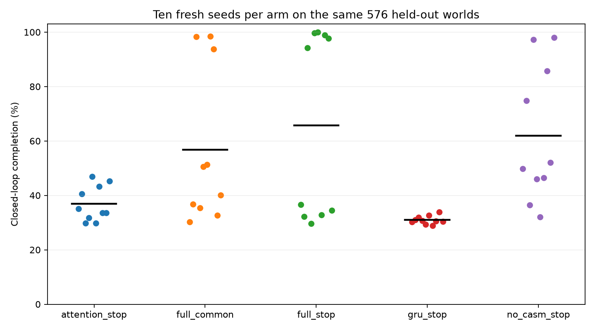
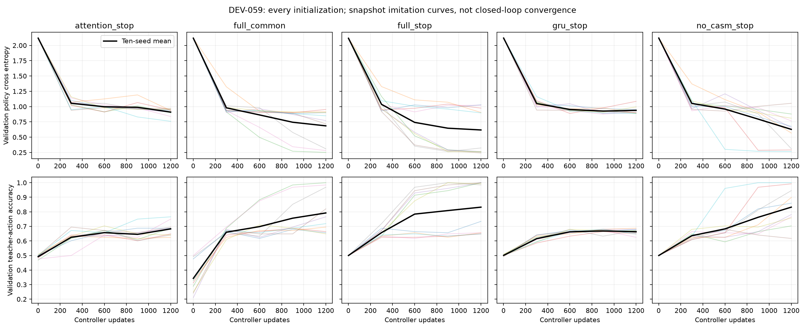

# DEV-059: ten-seed controls and a rejected learned stopping repair

**Development results; draft and unmerged. No model upgrade accepted.** Fifty
fresh main fits completed, but the registered architecture-wide superiority
gate failed. Fine-tuning the two DEV-058 checkpoints also failed its fresh-test
physical-reliability guard. The original DEV-058 default checkpoint remains
unchanged. Neither result establishes general learned world modeling.

## What remains learned

The deployed DEV-058 agent still chooses admission, memory addresses, CDL-style
reads, neural CASM operations, latent transitions and action/stop scores through
trained weights. DEV-059 does not add a scripted stop threshold, repair rule,
retry routine or analytical planner. Tensor shapes, candidate APIs and external
world verification remain programmed infrastructure. Neural CASM is not general
symbolic program discovery; original CDL distillation and C5 remain open.

The [retrospective audit](DEV-058-REVIEW-AUDIT.md) corrects the earlier evidence
interpretation: the public latest-record reference matches the private teacher
on every action in all 576 original test worlds, with 100% completion, 3.061
actions/world and total cost 2.2661. Perfect admission precision and recall
against explicit noise labels explain the approximately 91% skip rate. Those
logical skips do not remove dense encoder or memory-update tensor operations.
At all 126 physically healthy decisions within the repeat seed's failed worlds,
the strongest status read selected an older same-entity fault record. This is a
correlation, not proof that retrieval alone caused the failures.

## Registered common-target comparison

[Protocol](../research/dev059/protocol.json) was committed before main training.
Each arm trained ten fresh initializations (7781–7790), following a separate
learning-rate pilot at seed 7780. All five arms use the same 8,192 snapshots,
1,200 controller updates of batch 64 and common task targets. Each gets 1,200
pretraining updates. The slotted models additionally receive generic allocation
labels; raw-history controls pretrain a temporary noise classifier and retain all
records. The writer is frozen before controller fitting.

AdamW, clipping and pretraining settings are recorded in the protocol. Each
arm independently chose between learning rates 0.001 and 0.002 using its
validation-only pilot: full-common and attention chose 0.001; stopping-weighted
full, no-CASM and GRU chose 0.002. No test outcome selected these settings.

This changes the training problem relative to DEV-058: half its controller
updates, no read-address/graph-edge auxiliary task labels, and a new terminal
curriculum. Consequently it is a fixed-budget learning comparison, not an
attempt to reproduce DEV-058's original success or an equally converged,
globally optimized architecture ranking. Nominal samples/updates and parameters
are matched; actual CPU, state bytes and structural pretraining differ.
`full_common` and `full_stop` also selected different learning rates, so their
contrast compares recipes rather than isolating one loss coefficient.

All 50 fits completed before the new test was opened. Each evaluated the same
576 worlds (nine entity/history strata). These are ten model seeds on shared
worlds, not 28,800 independent environments. Costs charge actual interventions,
20 units per final fault, 0.01 per observation and 0.02 per logical write. The
last charge is a synthetic accounting convention, not measured memory traffic;
raw-history models retain every record and therefore pay more of that charge.

| Arm | Parameters | Persistent state bytes | Completion | Physically repaired | Final faults/world | Actions/world | Total cost/world |
|---|---:|---:|---:|---:|---:|---:|---:|
| Full, common loss | 133,580 | 6,272 | 56.75% | 57.03% | 0.871 | 3.748 | 20.177 |
| Full, stopping-weighted | 133,580 | 6,272 | 65.66% | 65.71% | 0.694 | 3.207 | 16.273 |
| Retrained no-CASM | 134,036 | 8,448 | 61.89% | 62.24% | 0.773 | 3.763 | 18.245 |
| GRU | 133,905 | 576 | 30.95% | 31.02% | 1.488 | 3.821 | 34.168 |
| Raw-history attention | 133,343 | 17,664 | 36.96% | 37.07% | 1.250 | 3.683 | 29.322 |

On these same fresh test worlds, the public latest-record reference and private
teacher again agree on every action: 576/576 completion and repair, 2.962
actions/world and cost 2.2035 (1.1771 interventions, 0.8730 observations,
0.1534 logical writes). The full stopping-weighted mean cost exceeds this
reference by 14.0699 units/world. The exact-information task remains solvable
by a public lookup controller; this is an essential ceiling, not evidence of
hidden-state inference.

The no-CASM arm deletes the operators and selectors before fresh optimization;
it is not a lesion of a jointly trained model. The GRU and attention references
have no learned admission, CDL or CASM. Their programmed recurrent/raw-history
buffers are conventional baseline mechanisms, not a claim of learned indexing.

| Full stopping-weighted minus comparator | Completion difference | Crossed bootstrap 95% interval | Holm-adjusted seed sign-flip p |
|---|---:|---:|---:|
| Full common | +8.91 percentage points | −13.82 to +30.35 | 1.0000 |
| Retrained no-CASM | +3.77 points | −26.06 to +34.98 | 1.0000 |
| GRU | +34.70 points | +15.45 to +54.60 | 0.0156 |
| Attention | +28.70 points | +7.20 to +50.85 | 0.1816 |

Intervals jointly resample initialization seeds and paired worlds within the nine
strata (2,000 replicates). Exact two-sided seed sign-flips and Holm correction
cover the four comparisons. The [full statistics](../research/dev059/statistics.json)
also retain paired-seed t intervals, every seed, cell, cost component, CPU time
and visited-state Brier scores. The Brier summaries were added after outcomes as exploratory diagnostics, not
registered gate metrics. Those Brier scores average decisions within a
world and then worlds; each policy visits different states, so they are not a
common-query calibration comparison.

Mean cost decomposition (units/world):

| Arm | Interventions | Final-fault penalty | Observations | Logical writes |
|---|---:|---:|---:|---:|
| Full common | 1.708 | 17.413 | 0.883 | 0.173 |
| Full stopping-weighted | 1.355 | 13.882 | 0.876 | 0.160 |
| Retrained no-CASM | 1.721 | 15.469 | 0.883 | 0.173 |
| GRU | 1.756 | 29.760 | 0.884 | 1.767 |
| Attention | 1.672 | 25.003 | 0.882 | 1.764 |

Only the GRU contrast passes the adjusted completion comparison with a favorable
fault interval under this budget. CASM contribution and a stopping-recipe benefit
remain inconclusive. The required advantage over all three learned controls is
**not established**. Full stopping-weighted seed completions range from 29.7% to
100%; choosing its best seed would conceal the principal reliability problem.

Curves are validation snapshot imitation diagnostics, not proof of closed-loop
convergence. No parameter-count, latency or storage advantage is inferred from
completion differences. The complete grid consumed 5,327.8 fitting CPU seconds
and approximately 49.6 minutes wall time, including pilots.

## DEV-059-R: inherited checkpoint repair rejected

The [separate repair protocol](../research/dev059/repair/protocol.json) was frozen
before its fitting or fresh holdout. Each of the two original DEV-058 models
received 600 fine-tuning updates, preserving the learned writer and original
read/graph losses while increasing healthy-state policy supervision. This is
two inherited models, not ten new independent initializations.

Both passed the preregistered validation gate. On the distinct 576-world test:

| Inherited seed | Variant | Completion | Physical repair | Residual faults | Missing stop | Cost/world |
|---|---|---:|---:|---:|---:|---:|
| 7581 | Original | 576/576 | 576/576 | 0 | 0 | 2.2346 |
| 7581 | Fine-tuned | 573/576 | 573/576 | 3 | 0 | 2.2896 |
| 7582 | Original | 568/576 | 575/576 | 1 | 7 | 2.3240 |
| 7582 | Fine-tuned | 564/576 | 564/576 | 17 | 3 | 2.8030 |

The first fine-tune stopped with faults in three worlds (originally zero).
The repeat fine-tune stopped with faults in nine worlds (originally one), and
its three budget-exhausted worlds also ended faulty; the original seven
budget-exhausted worlds were healthy. Seventeen residual faults are a fault
count, not seventeen independent failed worlds.

Fewer missed stops did not mean safer stopping. The repair increased physical
faults in both seeds and was **rejected**. All failed checkpoints and trajectories
are retained; no fine-tuned checkpoint replaces the working original agent.
These fresh-test figures differ from the original DEV-058 test because worlds
are new. No further recipe was chosen using these outcomes.

## Verification, scope and next boundary

Local verification passed **1,365 regression tests**, restored all sixty grid
fits plus four original/repaired checkpoint instances, and exactly replayed
**55,680 trajectories and 204,231 native actions** across 870 recorded cells.
Standalone exports reproduced 464 decisions. The 26,682 failed rollouts across
all fits and splits remain recorded; these are repeated evaluations of weak
experimental models, not distinct new worlds or failures of one deployed agent.
See the [audit record](../research/dev059/audit.json) and
[archive index](../research/dev059/evidence-index.json).

The evidence archive preserves all ten tuning fits, fifty fresh main fits, two
failed fine-tunes and their recorded validations/tests. The auditor restores
weights, checks hashes and frozen writers, reproduces public action/receipt
sequences, and exports each family to a standalone torch process without
TAC-OSM or Veritas imports. Native Veritas replay checks recorded consequences
against the same synthetic physics, not independent real-world ground truth.
Aggregate replay failures include pilots and weak experimental models and must
not be represented as failures of the original default model.

Main training source was frozen at `b498459`; later report source identifiers
can show `5ccbd08` because audit and repair-registration files were committed
while fitting. The main training/controller sources did not change between
those commits. Training snapshots can be regenerated from the protocol and
fingerprints; large redundant dataset tensors are excluded from the archive.

The [partial-observation follow-up](../research/dev060/PARTIAL-OBSERVATION-DRAFT.md)
is a **draft, not a completed experiment**. It separates a privileged teacher's
unattainable information advantage from a public-information belief baseline.
Unknown identities, noisy/missing observations, larger dependency structures
and drift still require preregistered tests. A model choosing actions from
weights is demonstrated on the earlier bounded task; reliable training across
seeds, partial-observation reasoning, general symbolic programs and scalable
learned acquisition remain unproven.
