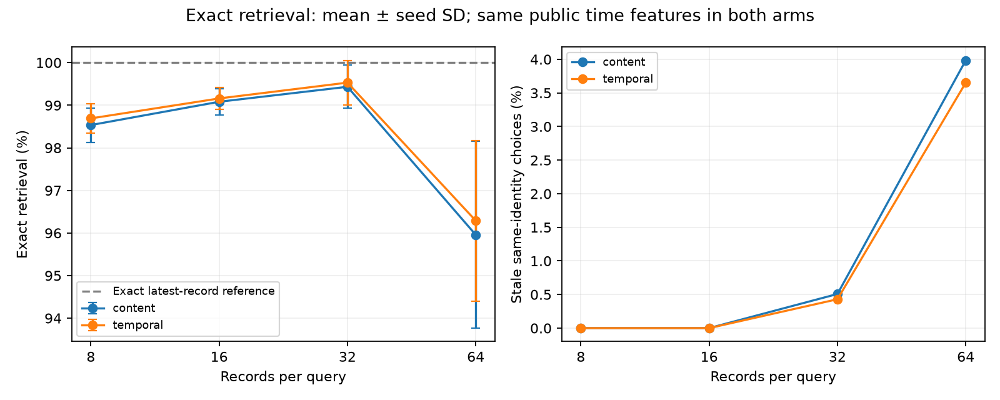
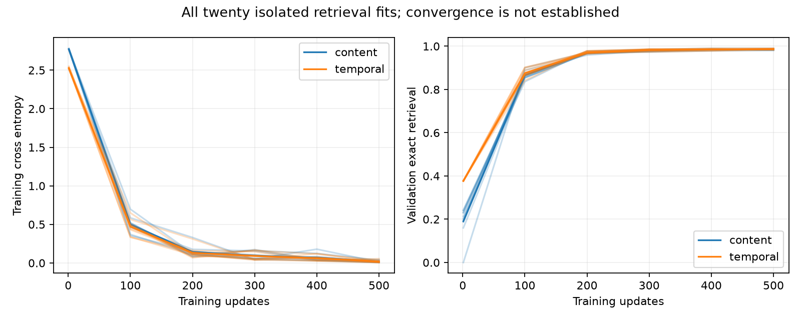

# DEV-060 foundations: sparse execution and uncertainty infrastructure

This is the first engineering tranche of the
[four-phase research program](WORLD-STATE-RESEARCH-PROGRAM.md), not completion of
DEV-060's larger learned-policy study. No new full agent was trained or promoted.
The original DEV-058 weights and their known failures remain unchanged.

Three independent lanes ran under a
[protocol committed before probe fitting](../research/dev060/protocol-foundations.json):
a ten-seed retrieval experiment, same-weight sparse execution verification, and
an executable uncertain-world/public-belief reference harness. This keeps
mechanical efficiency, learned retrieval, and partially observed policy claims
separate.

## Sparse inference now skips real network calls

`SparseTemporalAgent` is an optional torch-only implementation. In evaluation
mode it runs learned admission on each public observation, then runs addressing
and encoding only for admitted rows. A closed gate returns the existing state;
an admitted write uses copy-on-write and updates its selected slot. Dense
reference mode uses the same weights. Admitted writes still clone a bank, and
input validation/admission still process every observation.

With `temporal=False`, parameter names, weights, state shape and the action path
match the original agent. There are no new untrained policy parameters and no
stop/repair fallback. The original 6,272-byte state is retained. The auditor
reproduced **1,152 recorded rollouts and 3,747 native actions**, including both
original seeds' failures. These are 576 shared worlds per checkpoint, not 1,152
independent worlds. It also exported both models and reproduced **66 exact-logit
decisions across 24 demo trajectories** in separate torch-only processes with
research imports forbidden.

A downloadable [sparse runtime bundle](../research/dev060/sparse-agent.tar.gz)
contains both existing checkpoints and runnable public JSONL demos. Extract it
and run `python runtime.py < demo-requests.jsonl` inside either seed directory.
This is an execution optimization of the bounded original model, not a newly
trained, calibrated or generally reliable agent. The learned completion estimate
still requires external outcome verification.

CPU microbenchmark details and raw samples are archived. It uses 128 public
records, batch one, one torch thread, five warm-ups and thirty recorded timings
per implementation. Both paths admit eight records. Dense addressing/encoding
process 128 rows each; sparse processing handles eight each. Exact states,
addresses of admitted records and final action logits match. No physical DRAM
traffic is measured because hardware counters are unavailable. Positive net
operator allocation totals are allocator observations, not DRAM bytes or RSS.
The final local run measured median observe time **23.929 ms dense versus
8.103 ms sparse per 128 records** (2.95× in this microbenchmark), with p95
34.595 ms and 9.000 ms respectively. Positive net operator allocator bytes were
2,706,112 versus 126,208. Resident state remained 6,272 bytes in both paths.
These results are descriptive CPU samples; CI verifies semantics without a
speed threshold, and repeated hardware measurements may differ.

No whole-agent, GPU, batched-serving or quality-matched production speed claim
follows from this microbenchmark. The added temporal mode stores timestamps and
scans the bounded bank; it is not C5 indexed retrieval.

## Temporal bias did not establish a learned advantage

An optional nonnegative learned relative-age penalty biases read scores toward
recent retained records. It is an **imposed architectural prior**, not a
discovered temporal law. When content scores are identical, it favors the newer
record. It cannot guarantee that the entire model prefers a correct current
record, and newest-first processing is not generally valid for noisy sensors.
The operator-composition CASM stack is unchanged.

The isolated probe trains a small pairwise neural record scorer on continuous
opaque identities and exact conflicting public status records. Both content and
temporal arms see the same identity, status and timestamp information; only the
extra monotone penalty differs. Ten fresh initializations per arm train for 500
updates on 2,048 examples at lengths eight/sixteen. Test bank order is shuffled.
The exact latest-record reference gets 100%; no learned superiority over that
reference is possible. These probes are not the full agent's CDL/CASM policy.

| Records/query | Content exact | Temporal exact | Temporal stale same-identity choices | Adjusted p for temporal-minus-content |
|---|---:|---:|---:|---:|
| 8 | 98.535% | 98.691% | 0.000% | 0.625 |
| 16 | 99.082% | 99.160% | 0.000% | 0.750 |
| 32 | 99.434% | 99.531% | 0.430% | 0.750 |
| 64 | 95.957% | 96.289% | 3.652% | 0.750 |

Each probe has 1,698 stored scalar parameters; the content arm has one unused
frozen scalar, while the temporal arm trains that decay parameter. Fitting all
twenty models used approximately 16.85 child-process CPU seconds including
worker overhead, within the registered ten-minute cap. This small probe budget
does not establish whole-agent convergence.

Paired initialization sign-flips are two-sided, with Holm correction over four
lengths. All per-seed differences and t intervals are retained. Test length 64
extends beyond training lengths. Both scorers read every record, so this is not
a retrieval-compute scaling win. The twenty models share 2,048 held-out query
fixtures: their 40,960 recorded choices are not independent worlds.

**The zero-stale acceptance target is not met, and a temporal contribution is
not established.** Neither a successful mechanism test nor the high short-bank
accuracy proves full-policy stabilization. No new hypothesis, hyperparameter or
checkpoint was selected using these final test results.

## An executable uncertainty benchmark, with no learned-policy result yet

The small harness has two entities with new continuous eight-dimensional
identities in each world. Initial states are missing independently with
probability 0.5; visible initial statuses and repair receipts have 10% bit error.
Paid inspections give exact status with explicit public provenance. Public
relations disclose an acyclic pair or independence. Repair receipts always
include both identities, even if no physical state changed. The public payload
contains only event/candidate/query tensors, never true faults.

The reference tracks the exact joint posterior over four physical states. Its
known-law expected-cost planner uses depth two and replans after receipts. It
can pay for information, but it is not a globally optimal POMDP solver. A private
safe-progress teacher sees extra information; a deliberately simple public
latest-status shortcut illustrates failure of exact-log reasoning under noise.
The shortcut is not the strong primary comparator.

| Reference on the same 256 worlds | Completion | Final faults | Paid inspections | Mean total cost |
|---|---:|---:|---:|---:|
| Public joint belief, depth two | 256/256 | 0 | 210 | 1.3499 |
| Private safe-progress teacher | 256/256 | 0 | 0 | 0.9400 |
| Public latest-status shortcut | 163/256 | 116 | 0 | 10.0146 |

These are **hand-coded reference results**, not a trained world model. The
public-minus-private cost difference of 0.4099 includes information costs,
bounded-planner approximation and stochastic trajectory differences. It is not
an established irreducible information gap. Observed 256/256 completion is not
a universal guarantee or headroom for strict completion superiority.

Costs separately charge observations (0.01 each), inspections (0.1), repairs
(0.6), and 20 per final fault. This tranche does not add fictitious hardware
traffic charges. Full rows, actions and cost components are archived. Initial
uncertainty and repair receipt noise are distinct from exact paid inspections.

Tests verify posterior likelihoods, normalization, selected physical transition
probabilities, bounded-planner cost enumeration, a paid-information fixture,
receipt provenance and hidden-state non-access. Identical public histories can
correspond to different hidden faults and different private first repairs.
The small simulator and reference share the stated synthetic laws; there is
**no independent native Veritas integration for this new uncertain-world
harness yet**. Native replay above applies to the old agent's sparse-only path.
It is not external validation of the new sensor law.

## Calibration, decision risk and remaining gates

The code separates unweighted proper completion/outcome scores from asymmetric
candidate-risk training terms. This prevents turning cost-weighted class targets
into probability estimates. Shared policy gradients can still affect a shared
representation; separate loss names do not guarantee calibration. No newly
calibrated full-agent heads are claimed. Fixed-bin Brier/ECE summaries and
per-bin descriptive intervals are implemented; clustered world/seed inference
is still required for learned-policy comparisons.

Public-policy reference posterior diagnostics are included (Brier 0.07798,
fixed-bin ECE 0.01634 on visited decisions). These are finite correlated samples
and are not a claim of perfect calibration. Under a privileged
teacher, action choices depend on hidden state and can themselves reveal it;
its interventional filter diagnostic is explicitly excluded from a claim of
exact conditional calibration. The learned completion head does not verify
physical success.

The next full learned-policy protocol must freeze ten seeds, matched public
inputs, retrained no-CASM/GRU/attention controls, calibration splits, resource
budgets and fault guards **before fitting**. It must test representation error
on fixed histories separately from policy error and information limits. Larger
entity counts, unknown relations, drift, JEPA pretraining, symbolic discovery,
text interfaces, Woyengi/Jev/LLM comparisons and commercial validity remain
unimplemented by this tranche. The program document states their prerequisites
and prevents a successful microbenchmark from being promoted into those claims.
