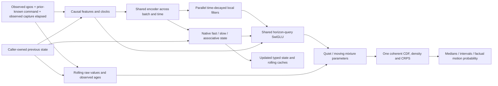

# Complete native input-to-output computational graph

This page describes the implemented ME087 physical forecasting graph. It is not
an assertion of general intelligence, causal control or predictive gate success.
Original numerical results and independent replay decide those narrower claims.

The pure function is

    (distribution_parameters_for_h1_h4_h16, S_next)
        = F_weights(observed_x, known_lag1_command, observed_elapsed, S_previous).

Future measured states occur only in the separate training/evaluation loss.
Future commands, future capture timestamps, hidden REPORT movement labels,
absolute epoch and episode/task IDs are not inputs. A source-authenticated
past/current capture clock is different from a retained-frame endpoint.

## Types of computation and reuse

* Dense projections and nonlinear encoders: one shared batch/time computation.
* Observed clocks: positive elapsed cumsum and causal change-prefix cummax.
* Multirate local processing: vectorized unfold/tap/age-decay reductions.
* Native recurrent integration: bounded fast/slow and error-correcting8x8 memory.
* Direct value retrieval: learned convex raw observation pooling with FIT-noise
  softsign-bounded quiet innovation, every coordinate, no true-regime router.
* Future queries: shared weights with parallel1/4/16-frame query embeddings.
* Probability computation: one two-Laplace mixture, positive scales, coherent
  quantiles and proper scores; marginal horizons, not an autoregressive path.
* Training: correct implicit derivative of the actual forecast median, with
  root values computed once without retaining root-iteration autograd tapes.
* Execution effects: an explicit entity/revision/sequence handler owns caches;
  exact retry reuses distributions without another neural call, conflicting or
  missing history fails closed. It confers no external state/action authority.

Only the native nonlinear recurrent state has a sequential event dependency.
Quantile bisection also has a fixed40-iteration dependency while all levels,
coordinates, batches and horizons are vectorized. There is **no claimed fully
parallel event scan, CUDA/Triton fusion or general-shape JIT export**.

## Actual verification and cost scope

The unfitted real-FIT raw-distribution graph exports2593nodes. All20learned
parameter tensors receive finite nonzero gradients under the real training
objective. Independent finite differences verify the implicit derivative for
all mixture parameter types. The first actual trained original's complete
forecast/state exports have3737prefill nodes and1505incremental nodes. Exported
values agree with the original graph at the unchanged numerical tolerance.

Prefill costs O(T) in actual supplied history. One incremental update uses
constant-sized state relative to past history length:1331tensor values per
entity (10648float64 bytes), excluding model weights, forecast buffers and
Python/tensor overhead. Chunk/step functional equivalence is an execution
property; arbitrary-history *predictive* accuracy is not qualified by it.

Two committed derived TorchScript executables cover B2,T32 and B2,T1 only.
They preserve complete quantiles/risk and13updated-state outputs, and pass
same-profile real-FIT value and serialized round-trip checks. Compilation can
remove dead graph work and Python dispatch. Measured alternating31-repeat
same-model medians: prefill7.74→4.13ms, step2.58→1.63ms (1.87x/1.59x). Both
training processes shared the workspace; CPU affinity was not pinned. These
are local profile observations, not hardware-general latency or rival claims.

**Learned-model budget remains99731.** Frozen compiled tensor constants retain
the original learned-weight provenance; an empty `program.parameters()` is
not a zero-parameter or budget exemption. Loading multiple program profiles
costs additional storage; no whole-runtime memory reduction is claimed. The
original guarded checkpoint is canonical. Compiled-profile restoration is
independent of original whole-cohort forecast replay and quality gates.
