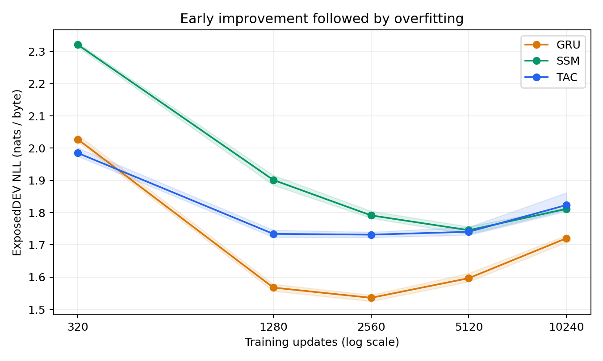

# CODEVALUE003 results

All nine original models completed10240 updates on two physically verified Tesla T4s. All45 model/optimizer/RNG/sampler checkpoints were sealed and the final internal resource gate passed. All392 score files were preserved. The remote run ended in ERROR after scoring, because NumPy integer win counts could not serialize to JSON. Local recovery converted those two counters to Python int, without retraining or producing new predictions. The original error and RUNTIME.json remain unchanged.

**Predeclared utility screen: FAIL. Commercial viability: not established.**

## Final transferDEV: five projects, ten files

| Predictor | NLL↓ | Next-byte accuracy↑ | Exact4 /5120 |
| --- | ---: | ---: | ---: |
| FIT-only P3 | 1.8925 | 55.04% | 1092.00 |
| FIT-only Witten–Bell order6 | 2.1173 | 60.67% | 1281.00 |
| TAC500K | 2.0230 | 58.01% | 1209.00 |
| GRU500K | 1.9114 | 58.94% | 1260.33 |
| Selective SSM500K | 1.9504 | 57.87% | 1224.33 |

Neural rows average all three registered seeds. Count rows are single deterministic FIT-only predictors. Fractional completion counts are averages. NLL is target-weighted; each neural model scored the same original transfer targets and5120 completion opportunities. These are separate project DEV measurements, not a strict blind or independent TEST.

TAC exceeds original P3 on exact4 completion rate by2.285 percentage points (publisher/file bootstrap95% CI1.608 to2.969), but trails Witten–Bell6 by1.406 points (CI−2.461 to−0.482). TAC loses exact4 to WB6 in all five publishers and all three seeds. TAC also fails the predeclared four-key wrong-suggestion cost scenario. These costs are simulations, not measured time or money. The simple baseline can have better argmax completion accuracy while worse NLL because NLL also penalizes probability calibration.

## Longer optimization and overfitting

| Update | TAC exposedDEV NLL | GRU exposedDEV NLL | SSM exposedDEV NLL |
| ---: | ---: | ---: | ---: |
| 320 | 1.9849 | 2.0275 | 2.3208 |
| 1280 | 1.7341 | 1.5675 | 1.9014 |
| 2560 | 1.7317 | 1.5358 | 1.7915 |
| 5120 | 1.7406 | 1.5966 | 1.7455 |
| 10240 | 1.8236 | 1.7206 | 1.8116 |

TAC learns useful code statistics: its final exposedDEV loss improves over320 updates in all three seeds. However, the mean curve is best around2560 updates and degrades afterwards. GRU also improves early then overfits, and is stronger at the fixed final endpoint on transfer NLL. Merely extending this small repeated FIT corpus does not deliver continued progress. The checkpoints are descriptive; no transfer-selected best checkpoint was substituted for the registered10240 endpoint.

The next research design should prioritize broader licensed training data, overfitting control and a preregistered DEV checkpoint-selection policy. Any new confirmatory transfer claim needs a newly frozen cohort; the current transferDEV results are exposed. This run does not measure general English, executable code correctness, developer acceptance, Android performance, willingness to pay or profit.

## Evidence and recovery

- Coordinator elapsed: 95.94 minutes on two observed T4s; allocated GPU-minute upper bound 191.88, plus the initial pre-training bootstrap failure. This stayed below the240 GPU-minute ceiling.
- Original45 checkpoints and392 score files: research/replay-bundles/CODEVALUE003. Checkpoint SHA256 identities match the pre-scoring seal. Saved generations are recomputed against immutable original publisher bytes during recovery.
- RECOVERY.json records zero new optimizer updates, zero new predictions and zero additional GPU minutes. The original serialization failure is retained in evaluation.log and RUNTIME.json.
- Full training FLOPs remain unmatched; architecture superiority is ineligible. Physical T4 verification and internal replay do not establish independent qualification. Protected TEST was not opened.
