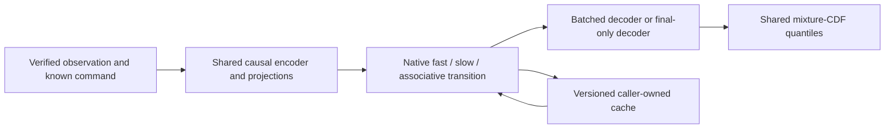

# Native TAC computation reuse

This is a **no-fit execution improvement**, preserving the ME080 architecture
and every original checkpoint. Read the [mathematical specification](MATHEMATICAL_ARCHITECTURE.md)
and the frozen [benchmark registration](REGISTRATION.json).

```python
from tac_osm.variants.reusable_execution import (
    BatchedMixtureWorld, EntityInferenceCache, mixture_quantiles,
)

model = BatchedMixtureWorld(identified)
model.load_state_dict(original_checkpoint['weights'], strict=True)
model.eval()

# Offline training preserves all-prefix autograd; no detached inference cache.
all_prefix_distributions = model(observed_chunk, known_commands)

# Query only the current forecast, without decoding every historical position.
current_distribution = model.forecast_last(observed_chunk, known_commands)
lower, median, upper = mixture_quantiles(current_distribution)

# Ordered incremental inference; caller supplies actual version identities.
cache = EntityInferenceCache(
    model, model_revision=checkpoint_sha256,
    preprocessing_revision=fit_statistics_sha256,
)
forecast = cache.step('asset-123', 0, first_observation, known_command)
```

Both input tensors in `cache.step` are 1×14, already transformed with the frozen
FIT statistics and matching model dtype/device. Commands must be available at
prediction time. Exact retry of the latest event reuses its output. Gaps,
conflicting retries, model changes and capacity overflow fail explicitly.
Historical corrections require reset and verified-prefix replay. Serialize
cache calls; this research handler is not a production concurrency service.

The original model used eight-frame resets for training/scoring. An incremental
stream is equivalent to a full **carried-state** prefix computation, not to a
sliding eight-frame reset window. Long-history accuracy remains unqualified.
No original ME080 score, checkpoint, tolerance or failed gate is modified.



The cache arrow carries explicit recurrent state, not a detached training graph.
For exact latest-event retries, the handler returns its stored forecast without
re-entering the neural graph. New verified observations always update state.
