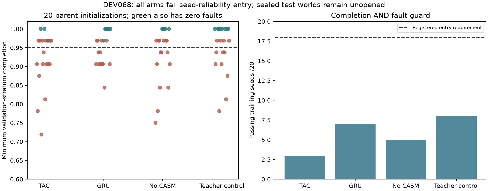
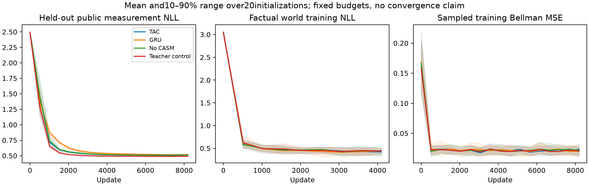

# DEV068 — outcome-derived learning works; reliable control does not

All80registered fresh fits plus8pilots completed. Every action score is learned;
the primary arms use actual public inspection receipts and verified outcomes,
not analytical posterior/transition/action-teacher targets. **The selected GRU
passes the per-seed validation screen in only7/20seeds;18were required.** No model
is promoted and all reserved test worlds remain unopened.

## Registered validation result

Each model is evaluated on32paired initial worlds at H32/H128. These are shared
validation worlds reused across initializations and histories, not thousands of
independent physical trials. Every row below summarizes20training initializations.

| Arm | Passing seeds/20 | Mean completion | Final fault bits,1280rollouts | Mean task cost/world |
|---|---:|---:|---:|---:|
| TAC outcome | 3 | 92.50% | 90 | 4.1046 |
| GRU outcome, preselected candidate | 7 | 95.08% | 53 | 3.5191 |
| No-CASM outcome | 5 | 93.36% | 74 | 3.9053 |
| Explicit teacher-belief control | 8 | 94.84% | 59 | 3.6159 |

Passing requires>=95%completion AND zero final faults in EACH validation stratum.
A95.08%pooled average does not establish reliable seed convergence. Task cost is
synthetic observation/inspection/repair fees plus20per terminal fault bit, not
actual commercial maintenance prices. The additional20noncompletion penalty is
training-only and is not silently added to reported task cost.

Failures are not merely delayed stopping. TAC/GRU/no-CASM/teacher have43/29/30/15
false stops and14/10/11/15healthy-budget-exhaustion cases respectively. They also
create171/161/149/162fault bits through interventions before later repairs. Final
fault counts alone therefore understate physical disruption.

## What was learned, and what was supplied

Three primary arms learn a12-class paired-inspection/graph state distribution,
a21-class action-conditioned future-verification distribution and physical cost,
then a learned Q policy. Prediction networks freeze before Q training; no current
state/actor latent bypass enters the policy. The fourth arm is explicitly labeled:
its state encoder alone uses known-law PUBLIC posterior supervision. It cannot
qualify an outcome-only candidate. Deployment imports no analytical filter,
physical transition law, action teacher, search planner, retry or stop heuristic.

The architecture is not scaffold-free. Supplied structure includes46typed fields,
two public16-vector entity identifiers, cosine identity binding, FIFO64, six-type
noise-gate supervision, five action choices,12/21state vocabularies, action budget,
objective definition and independent verifier. The recurrent encoders process the
retained history; this is not discovered entity ontology or arbitrary-size memory.
CDL-style attention and three densely evaluated neural CASM MLPs remain neural
modules, not symbolic program discovery or demonstrated sparse/C5computation.

Mean held-out measurement NLL is0.5041TAC/0.5117GRU/0.5044no-CASM against1.2402
for the train-only empirical graph-conditioned prior. This supports learning useful
public-history prediction, not calibrated world-model mastery or safe action
selection. Teacher control NLL0.4844does not repair policy reliability either.

All full fits receive8,192encoder,4,096world and8,192value updates. The plotted
budgets/curves are not convergence proof; no best-epoch or lucky-seed checkpoint
selection occurs. MTSK novelty remains retired; no CASM superiority follows.

## Public-outcome acquisition and limits

32,775factual training actions across7,336procedural episodes and520validation
actions are preserved. State labels use two additional paid exact inspections
before each main action, WITHHELD from the student's shadow history. Training
label acquisition requires65,550extra calls and9,015.70synthetic fee units;
validation requires1,040extra calls/147.90units. Main training fees10,191.35,
initial observation fees5,868.80and terminal penalties101,500are separately
recorded. These are simulation accounting, not real prices or ROI.

The synthetic state is static between interventions; the additional probes do
not physically change it, although they advance RNG/action-clock counters. Real
inspections may violate this assumption. Exact public receipts provide labels;
hidden fault bits/private transition tables never enter primary model inputs or
loss targets. Teacher-only targets are a separate file and control loss.

## Semantic interventions, diagnostic only

Predeclared interim analysis uses the first14completed seeds on already-exposed
validation worlds. Exact beliefs reduce GRU fault bits49->44but do not solve
control. Replacing ALSO the forecast/cost interface with known-law expected values
reduces GRU completion841/896->642/896and increases healthy exhaustion6->158.
Other arms show similar fragility. These are OOD input interventions with an
unchanged learned Q, not an optimal oracle comparison or proof of isolated
policy causality. They motivate testing a probability-linear utility readout
while freezing the same memory/dynamics, not silently substituting a planner.

## Reproduction and execution

- All88final EMA checkpoints replay5,632validation trajectories.111,844scalar
  comparisons match exactly locally; both public datasets and separate teacher
  targets independently reconstruct exactly.
- Native pinned Veritas replays4,114actions from first-pilot/first-fresh-seed
  trajectories, including failures. Its effect tables derive from the same
  synthetic physics, not independent real-world verification.
- Four first-declared fresh-seed Torch-only exports reproduce29decisions with
  NumPy/TAC-OSM/Veritas imports forbidden.176clock cases and88prediction-to-policy
  interface cases pass. Remote portability requires its own exact-head check.
- An executor loss interrupted two fits after14completed groups. Partial curves
  were retained and the SAME seeds restarted with unchanged fitting source.
  Actual completed fitting used17,773.66CPU seconds. Conservative setup/lost-fit
  charges bring the upper account to21,467.66,below24,000. Exact lost-process CPU
  is unknown; this is a bound, not a hardware-efficiency measurement.

DEV068 saved final EMA checkpoints, not raw optimizer/intermediate state; this
limited exact mid-fit resumption. DEV069adds atomic raw/EMA/optimizer/RNG snapshots.
The administrative single-group scheduling allowance, initial portability failure
and correction, failed seeds and all source/data/evidence hashes are preserved.

The actual measured REAL003room forecaster and rejected REAL004field-repair
predictor remain separate studies. No commercial maintenance agent, complete
learned architecture, broad real-world reliability or profit is established.
