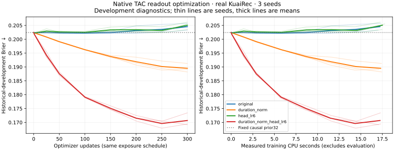

# ME022 — native TAC readout conditioning improves real development learning

**Completed: 12 native fits, 3 unmatched tiny references.** The fixed combined
duration-normalization + head-LR×6 change lowers mean native TAC Brier from
**0.204557548 to 0.170686756**, a **16.56% relative reduction**, on the original
5,952 historical development events. All 3 paired seeds improve. This passes the
registered engineering-candidate gate (all 3 better, mean reduction >= .005).
No independent test was opened and no model or architecture is promoted.

This is a change to the native model's input/readout learning, with **no new
memory, feature channel or trainable parameter**. Both recurrent equations,
135,050 trainables, causal prior32, real 128-event histories, initialized weights,
sample-index sequence, 300 updates and batch 128 are fixed across the four arms.
The user requested TAC improvement; other recurrent architectures are not refit.

## Registered factorial result

| Native TAC configuration | Seed 14001 | Seed 14002 | Seed 14003 | Mean Brier | Mean log loss | Mean training CPU s |
|---|---:|---:|---:|---:|---:|---:|
| Original | .204670 | .205712 | .203291 | .204558 | .595952 |17.21|
| Normalize current duration | .189074 | .191273 | .188208 | .189519 | .558506 |17.30|
| Head LR×6 | .205545 | .206157 | .203483 | .205062 | .597242 |17.49|
| Both | **.169430** | **.173441** | **.169189** | **.170687** | **.508739** |17.22|

Primary combined-minus-original paired Brier deltas:
**−.035239786,−.032270401,−.034102189**; mean **−.033870792**. Seeds are not
independent user samples; no independent generalization confidence interval is
claimed. Exact scores and traces: [recorded-results.json](recorded-results.json).

The normalization-only mean improves 7.35%; faster head learning alone slightly
worsens Brier. Factorial duration main effect −.0247071, head-LR main effect
−.0091637, interaction −.0193362 Brier. The strong interaction means a higher
learning rate is useful here **in combination with conditioning**. It does not
license a universal learning-rate change or a claim of full convergence.

FIT-only duration mean .768345535 and std .049314242 reflect the inherited
`log1p(video_duration)/12` units. A standard deviation of this predictor is small
in the raw coordinate. At the final head, its mean one-standard-deviation logit
effect has magnitude about .00385 for original TAC versus 1.1380 for the combined
arm. This is consistent with an input/readout optimization bottleneck. It does
not prove that every memory failure was caused by duration scaling.

Curves include steps 0, 1, 25, 50,100,150,200,250,300, with common data draws and
actual training CPU. Thin lines are seeds; thick lines are means. Final step
only was scored for the decision rule: no best-checkpoint selection or retuning.

## What remains weak

**Calibration did not improve with predictive discrimination.** Combined mean
ROC AUC rises .671729→.798532 and log loss falls .595952→.508739, but descriptive
ten-bin ECE worsens **.026219→.037490**. Better Brier is not a calibration or
reliability qualification. No development calibrator was fitted to hide this.

**Neural memory is still not earning demonstrated incremental value.** The
registered frozen knockout zeroes only head coefficients for fast/slow states;
it keeps the causal prior32, current action embedding, duration and intercept.
For the combined arm its mean Brier is **.168003**, better than the full
.170687 by .002684. All three combined seeds improve under this knockout.
Original/native normalization/head-LR arms also improve on average when these
coefficients are removed. This is an OOD internal diagnostic: zeroing can shift
an intercept as well as remove information, so it does **not** prove that all
history is useless or that retrained memory-free models will dominate.
It does block crediting the 16.56% gain to better long-history memory learning.

Fixed causal prior32 Brier is .202427. The separately labelled 225-parameter
ME021 summary MLP averages .174375 on these **same historical DEV events**, using
richer explicit rate summaries and its own existing recipe. These are practical
references, not parameter/compute-matched architecture rivals. Do not compare
this DEV result to ME021's .169752 first-user5 score as if they were the same
population, or infer TAC superiority over MLP from the DEV table.

## Evidence, resource and execution boundaries

Publisher KuaiRec `big_matrix.csv`, archive SHA256
`c23f211cf109c7a060a25a4afe9e8c681b1ccbbc816cca921d87ad37dd11c70c`;
Zenodo 18164998, CC BY 4.0 per publisher metadata. Attribution: Gao et al., CIKM
2022, DOI 10.1145/3511808.3557220. Exactly 10,776 FIT windows before Aug 1, 2020 and
5,952 previously inspected DEV windows Aug 1–13, only user_id%16=0. Source hashes,
invalid/missing record exclusions and chronological boundary checks passed.
No user1–5 or other cohort targets and no outcomes from Aug 14 onward interpreted.
This is logged factual watch prediction, without action intervention efficacy.

Primary training registration was frozen at `f88abac`, execution initially at
`77f4b78`. A post-fit TorchScript timing error interrupted after original
seed 14001's300 updates. The checkpoint was restored without refitting; all other
fits ran under `c7fd9ed`, with unchanged training math/hyperparameters and data.
[Execution amendment](EXECUTION-AMENDMENT.md) preserves the failure and limits.
All 3 original scores reproduce the historical ME019 values to rounding precision.

Native training consumed **207.70 process CPU seconds**, 17.01–17.78 per fit,
all below the common 180-second ceiling. Same 300 updates/38,400 sampled target
presentations per arm. Source building took 218.02 wall seconds; resumed execution
took 247.25 wall seconds. The first interrupted attempt's remaining overhead was
not metered at exit, so do not present these as complete end-to-end cost.
All native arms have the same 112,206,976 analytical affine forward MACs per
batch 128; this excludes elementwise/backward/embedding/optimizer work. It is
not an audited total FLOP count. Tiny references took about .10 wall seconds each.

Parity audit: parameters **PASS**, original inputs/data/exposure **PASS**,
tuning/selection **PASS**, same DEV evaluation **PASS**; equivalent actual total
compute **UNESTABLISHED**, independent test **NOT OPENED**. Equal ceilings and
similar CPU times do not prove equal full resources. **No architectural
superiority claim**, including over another memory architecture, follows.

The float32 zero-overhead folding attempt fails its unchanged1 e-6 probability
tolerance on one registered model; preserve it without qualification. Accepted
standalone exports retain the exact two-scalar normalization. Original model
scores are unaffected. See [export audit](EXPORT.md) and
[reproduction instructions](REPRODUCE.md).

Next architectural question: with the output-scale bottleneck removed, can
centered/regularized state readout or a causal auxiliary objective make learned
fast/slow state improve factual prediction? Preregister that intervention and
its retrained controls separately; keep all reserved tests closed during this
development stage. This experiment does not resolve128 vs32 memory, CDL/CASM,
decision reliability, independent transfer or commercial qualification.
