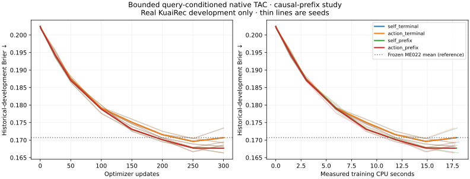

# ME023 — predictive native TAC: prefix learning helps; action-query gate fails

**All 12 registered fits completed. The registered primary did not pass.**
The action-query head has no reproducible advantage over its exactly matched
self-query control: primary mean Brier difference **+0.000006871**. A useful
secondary result is that causal prefix training improves both native variants
in every seed, with stronger state-use diagnostics and modestly better ECE.
No model is promoted and reserved outcomes remain closed.

## What was mathematically engineered

The reusable optional Torch core adds a bounded bilinear memory readout,
shared causal predictions at depths 32/64/96/128, and an exact native streaming
transition. Native fast/slow state equations are preserved. Every experimental
cell has **135,562 active parameters**: the established 135,050 plus 512 active
interaction coefficients. There is no dummy parameter padding.

For `r=(h/8)^T B tanh(e(a))/sqrt(8)` and
`B=4 tanh(U)/sqrt(512)`, the added interaction satisfies **|r| <=4**.
Its action-query state partial has norm **<=0.5**. These bounds are for the
added term; they do not bound the full linear head or prove memory contraction.
The complete derivations, mixed derivatives and computational accounting are
in [MATHEMATICS.md](MATHEMATICS.md). Eight mathematical/causal/serialization tests
exercise the implementation, not a generated capability benchmark.

The original additive log-odds limitation is now expressible through a real
parameter path. Expressibility does not imply an empirical win. The present
logged-video task and training budget do not establish value from action-query
conditioning. This result must remain alongside the implementation.

## Fixed factorial matrix

| Native configuration | Seed 14001 | Seed 14002 | Seed 14003 | Mean Brier | Mean ECE | Mean-state Brier delta |
|---|---:|---:|---:|---:|---:|---:|
| Self query, terminal loss | .169438 | .173436 | .169193 | .170689 | .037521 |−.001975|
| Action query, terminal loss | .169475 | .173405 | .169182 | .170687 | .038146 |−.001965|
| Self query, prefix loss | .168544 | .168175 | .166339 | **.167686** | .034921 |+.000657|
| Action query, prefix loss | .168604 | .168147 | .166327 | .167693 | .034961 |+.000629|

Mean-state delta is the error increase after replacing each learned state by
that model's **FIT-first 1024 mean state**, keeping current action, duration and
actual prior 32. Positive is consistent with useful varying state under this
intervention; it is not a causal-memory or independent-generalization estimate.

### Registered primary: reject the action-query advantage

`action_prefix − self_prefix` paired seed deltas:
**+.000060307, −.000028470, −.000011225**; mean **+.000006871**.
The rule required all 3 negative and mean <=−.0005. It fails both requirements.
The additional action-prefix mean-state guard also fails in seed 14001:
its +.000135177 is below the declared +.0002 floor. Do not loosen these gates,
rename the secondary as the primary, or claim action conditioning is qualified.

### Secondary: causal prefix supervision is promising

Within the same self-query architecture, prefix loss lowers mean Brier
**.170689134→.167685907 (1.76%)**. Within action-query it lowers
**.170687376→.167692778 (1.75%)**. Both improve in all 3 paired seeds. The former
is also about 1.76% below the frozen ME022 mean .170686756; that older score is
a historical reference, not a new fully matched architecture comparison.

Mean ROC AUC rises .798529→.805784 for self query and .798559→.805662 for
action query. ECE falls .037521→.034921 and .038146→.034961, respectively.
Calibration remains imperfect and is not a reliability qualification.

Unlike every terminal-only seed, all 6 prefix-trained cells become worse under
FIT-mean-state replacement. Self-query deltas are +.000208248, +.000487079,
+.001276974; action-query deltas are +.000135177, +.000468803, +.001282106.
This is more encouraging than the negative ME022 zero-state diagnostic and
reduces its intercept confound. The intervention remains OOD, state contents
can encode recent information, and no 128-vs 32 or unseen-user conclusion follows.

The objective provides 4 real response losses per sampled window rather than 1.
It changes supervision/credit allocation deliberately; it is not a free
architecture improvement under identical supervised-target exposure. These
secondary results need a separately registered replication before promotion.

All traces include 0, 1, 25, 50, 100, 150, 200, 250, 300 updates. Only final step 300 was
used; no best-step selection, retuning, added seeds or extra fitting occurred.

## Real data, resource parity and provenance

Original KuaiRec publisher archive SHA256
`c23f211cf109c7a060a25a4afe9e8c681b1ccbbc816cca921d87ad37dd11c70c`;
Zenodo 18164998, CC BY 4.0. Attribution: Gao et al., CIKM 2022,
DOI 10.1145/3511808.3557220. The already-exposed parent snapshot and all 12 original
parent weight hashes were verified before reading responses. Exact canonical
tensor/user/time fingerprints match the original source reconstruction.

Exactly 10,776 FIT windows before Aug 1, 2020 and 5,952 historical DEV windows Aug 1–13,
user_id%16=0 only. Missing/invalid records, causal history, chronology and sampling
inherit the original authenticated parser. No source download was needed.
No other user cohort or outcome from Aug 14 onward was interpreted.

All cells: same seeded native initialization, zero interaction, same deterministic
sample draws, 128 genuine preceding records, 300 AdamW updates, batch 128, LR .001
body/.006 head+interaction, clip 1 and weight decay .0001. Each sees 38,400 windows
and 4,915,200 historical event presentations. Prefix cells supervise 153,600 responses;
terminal cells 38,400. Observations overlap across windows; these are not counts
of independent people or newly acquired events.

The primary comparison has equal parameters, real inputs, window exposure,
supervised-response exposure and selection opportunities: **PASS**. Same
180 process-CPU-second ceiling for every fit; observed 17.64–18.15 seconds each,
**213.88 training CPU seconds total**. Complete run, including source verification,
diagnostics and serialization, took 262.53 wall/262.50 process-CPU seconds. Similar
CPU and equal ceilings do not constitute a complete FLOP/energy parity audit:
full compute parity **UNESTABLISHED**, independent test **NOT OPENED**. No
fully matched architectural superiority claim is allowed.

Training source and contract frozen at `4b17f08c7db03976eb6795a9d2fc810312acd124`.
No fitting-source repair or failed fit occurred. The streaming operator was
added after fitting, with no changed parameter or training equation. Original
standalone artifacts remain intact; separate streaming graphs are validated.

## Numerical and execution engineering

All 12 weights, original standalone paths and FIT-mean-state predictions replay
**71,424 genuine DEV forecasts per path with zero local difference**. The learned
readout matrix spectra are archived as diagnostics, not recurrent spectra.
For every model,32 real windows also agree exactly between 128 streamed transitions
and full-window state/readout. Original and separate streaming exports coexist.
See [STREAMING.md](STREAMING.md) for API ownership, prior 32 FIFO and input-memory
limits. This establishes arithmetic equivalence, not new long-stream accuracy.

**889 tests pass.** The lightweight package import still does not import Torch.
Recorded-only CI performs no fitting or source/test opening. Raw metrics,
optimizer/RNG, all attempted weights, exports and fingerprints are preserved;
[REPRODUCE.md](REPRODUCE.md) gives replay instructions.

The supported next direction is shared causal predictive training and measured
state utility. Action-query conditioning is an implemented but unqualified
extension. See [ARCHITECTURE-DIRECTION.md](ARCHITECTURE-DIRECTION.md) for the
separate roadmap toward stronger dynamics/depth/execution. This experiment
does not establish SSM/LLM-scale capability, symbolic CASM, causal decisions,
physical repair outcomes or commercial qualification. Overall research ACTIVE.
