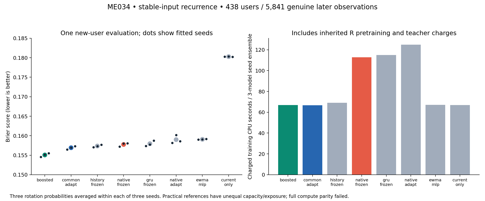

# ME034 — Frozen inputs help native TAC, but new-user qualification fails

Completed 2026-10-21. [Draft PR296](https://github.com/FPC-effortless/TAC-OSM/pull/296).
Protocol/source freeze `260fd62b6ea60cec9adefd3410e8d2160a2817e8` preceded all
72 fits and final-cohort access. No model promoted or merged.

## Registered new-user result

5,841 genuine KuaiRec next-response observations from438 previously unscored
users, user_id%16=6, targets2020-08-14 through2020-09-06 exclusive. Source ZIP
SHA256 c23f211cf109c7a060a25a4afe9e8c681b1ccbbc816cca921d87ad37dd11c70c;
the actual431,964,858 downloaded bytes matched the publisher MD5 and pinned SHA.
Final snapshot and individual payload hashes appear in the manifests. Remainder6
is now exposed and cannot supply another independent first-exposure claim.

Each reported seed averages probabilities from its three frozen role-rotation
models. Table entries average metrics across seeds14001/2/3; they are not metrics
of one best checkpoint or an ensemble selected using final outcomes.

| Model | Mean Brier ↓ | Mean AUC ↑ | Mean ECE10 ↓ | Active downstream weights |
|---|---:|---:|---:|---:|
| Gradient boosting |0.155063|0.828871|0.023666| unmatched tree reference |
| Common-head adaptation |0.156920|0.822388|0.018420|1205|
| Frozen pooled history |0.157363|0.821525|0.018529|8772|
| **Frozen-input native TAC** |**0.157756**|**0.820662**|**0.019575**|**8236**|
| Frozen-input projected GRU |0.157958|0.820174|0.019404|8244|
| Adapted-input native TAC |0.158996|0.818185|0.022085|136236|
| EWMA-feature MLP |0.159072|0.819721|0.032575|225|
| Trained current-item-only head |0.180285|0.758821|0.013685|517|

Full logloss, per-seed and per-cell metrics, costs and original records:
[results.json](results.json), [metrics table](metrics-table.md), [summary](summary.json).

### Primary gate: FAIL; registered stop applied

Frozen native minus common-head adaptation:

- Brier **+0.0008361233**; Bonferroni97.5% user-clustered interval
  **[+0.0001408433,+0.0015009782]**. All three seeds worse.
- AUC **−0.0017266779**; Bonferroni97.5% interval
  **[−0.0030036942,−0.0003780382]**. All three seeds worse.
- Calibration guard passes; both predictive gates fail. The required Brier
  improvement was at least0.001 with interval upper bound below−0.001, not merely
  a favorable point estimate.

The two intervals use3000paired user-clustered resamples, seed34034, nominal
familywise error<=.05 across the two registered endpoints. They condition on the
fixed trained models and approximate sampling uncertainty across users, not
retraining uncertainty. Secondary contrasts are descriptive, with no unadjusted
significance claims or post-hoc model selection.

**Close this stable-input native KuaiRec recipe and retire positive native-memory
claims on this task.** Do not reopen remainder6 for tuning, another fresh-test
claim, new gates, hierarchy or latent reasoning. Preserve the negative result.
Failure does not prove that every recurrent architecture, training objective or
real-world task must fail. It also does not establish that future progress must
belong exclusively to readouts.

## What improved, and what remains unproved

Freezing native inputs improved final mean Brier by0.001240576 versus the
adapted-input native control, with favorable direction in all three seeds
(−0.000985215,−0.002210299,−0.000526213). This is a descriptive treatment result,
not a full matched-capacity architecture win. Active downstream coefficients
drop by128000; the same pretrained information remains in the frozen table.
Mean charged S training CPU falls from19.6109 to15.5647 seconds per fit.

On reused FIT-user cross-validation, corresponding native scores were0.167886
adapted and0.164488 frozen; common0.161827 and boosted0.160283. Final accuracy
must not be compared directly with CV as an intervention effect: populations,
dates and within-seed rotation ensembling differ.

Stable embeddings help this native recipe, but do not identify why. Coordinate
drift, reduced overfitting from128000 fewer adjustable coefficients, inappropriate
embedding learning rate and optimization effects remain distinct hypotheses.
This experiment freezes E, not the learned event encoder or observation
distribution. It is not proof of a unique dual-instability root cause.

The current-item-only reference scores0.180285 versus common0.156920, a
descriptive gap0.023366. Historical summaries cannot be dismissed as irrelevant
on the basis of pooled permutation invariance. However, the no-history reference
also differs in parameter count, initialization and use of R-head pretraining;
the gap is not an isolated information-theoretic history-value estimate.
The common model itself uses real historical features; it is not history-free.

The candidate trains native dynamics and its added centered readout while the
inherited common head remains frozen. Joint adaptation of that common head with
frozen-input memory is not tested here. This limitation does not waive the
registered stop or permit retuning on the newly opened population.

Boosting gives the best recorded Brier/AUC, but worse ECE than the common head.
It has different parameters/exposure, so this is a practical reference finding,
not a fully matched architecture ranking or an automatically qualified replacement.

## Leakage audit and provenance

The conjectured one-table-on-all-FIT pretraining is absent from ME031–ME034.
Each of the nine inherited tables exactly matches its original R-only encoder
checkpoint. Each rotation's R,S,T user sets are pairwise disjoint. R-only duration
normalization, item popularity, common-feature normalization and EWMA-feature
normalization were rebuilt and checked. The original R common head is hash-bound
and checked on restoration. No pretraining was rerun in ME034.

A repository audit pinned331 remote refs and inspected593 unique Python script
blobs, tracing relevant KuaiRec readers to remainders0–5. It found no prior
remainder6 reader. This is evidence from repository records, not proof against
undocumented manual/outside access. The original data parser rejected other
users before outcome interpretation and checked publisher bytes before parsing.
All63 neural models and9trees were frozen and digested before any new CV metric;
the final-access receipt followed independent checkpoint/optimizer checks.

This is a new-user, later-target test within one existing observational dataset.
It does not establish causal recommendation value, long-term satisfaction,
real equipment action reliability, maintenance ROI or broad SSM/LLM competitiveness.

## Resource parity and exact engineering

Native frozen and GRU have8236 versus8244 active S parameters (0.0972% gap),
identical S examples, four targets and300updates. Dense memory MAC gap0.4673%;
warmed B8 forward/backward operator subtotal gaps0.3962% before fitting and
0.7080% on trained replay, both below registered2%. Unsupported operations,
optimizer/context work and unequal actual CPU prevent full compute-parity
qualification. Native/common/freeze-adapt and other unequal-parameter controls
fail the full parity contract. **No architecture-superiority claim.**

63neural fits each consumed38400drawn histories/153600response presentations;
9trees consumed100boosting iterations with all S four-prefix rows. Historical
R300+common500 costs are charged equally per pipeline but were not physically
rerun. New fit-phase physical CPU486.3823s / wall486.5955s; final acquisition,
parsing/evaluation CPU67.0490s / wall206.6586s. Per-arm actual costs and process
peak RSS are recorded separately. Equal CPU caps are not equal spend.

The generic raw-input runtime shares exactly equal frozen input/context tables
for27eligible native/pooled/GRU models. Each saves**512000unique tensor-weight
bytes**, and all recorded forecasts remain bit-exact. This excludes buffers,
activations, input histories and serialization overhead. GRU's fixed output-map
buffer adds9216bytes. Recurrence state alone is256B native or144B GRU, not the
complete serving state. Measured steady-state B128 full-window inference medians
are12.25ms native frozen and10.13ms GRU on this CPU implementation; no general
inference scaling or training-speed equivalence follows.

Post-fit diagnostics use only the first256 archived final windows per model.
Within-block sequence-only shuffling with common context held fixed raises native
Brier by0.000931 on average; pooled changes are rounding-level. Native zero-state
substitution improves Brier by0.004238 on average on this subset. These are
distribution-shift/substitution diagnostics, not primary population tests or
proof of temporal information presence/absence. No diagnostic selects a model.

## Verification and artifacts

- 971 regression tests and12subtests passed; scoped GitHub checks are recorded.
- 63original neural checkpoint/Adam/sampler/freeze receipts checked.
- **594279neural forecasts** replay exactly through each of checkpoint,
  original scripted and complete raw-input pipeline paths.
- **84897tree forecasts** replay exactly from original serialized trees.
- All63raw pipelines load in fresh Torch-only processes:252forecasts exact.
- 6982848context values rebuilt; final ensemble metrics and both adjusted
  bootstrap intervals independently reproduced.
- Corrupted checkpoint bytes fail verification before source access.
- Original checkpoints, final data, raw runtimes, traces and parent audit support
  are preserved; see [artifact and offline restoration](ARTIFACT.md).

