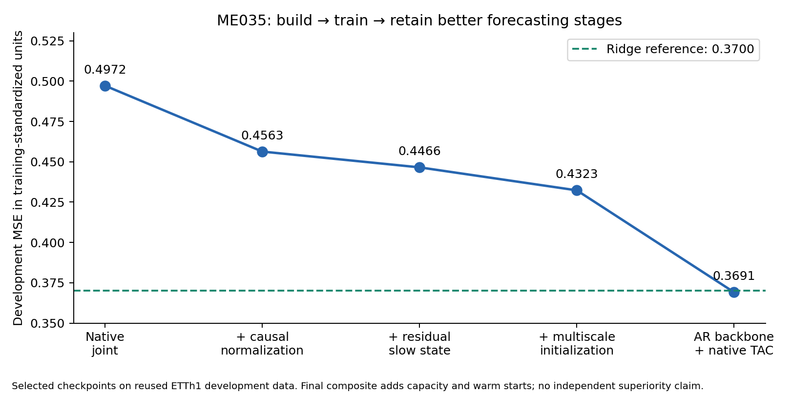

# ME035/ME035B — A better trained native forecasting model

[Draft PR297](https://github.com/FPC-effortless/TAC-OSM/pull/297).
The work implements, trains and retains architectural improvements. It does not
run a new standalone diagnostic gate before allowing model development.

## Measured development progress

Authentic hourly ETTh1 transformer measurements, all7channels forecast at1,6,24h
from96observed hours. 2881training windows;476previously exposed development
windows. Three training seeds,15neural fits plus1ridge fit across two explicitly
registered rounds. Metrics use training-only standardized channel units.

| Trained model | Active weights | Selected update | Mean MSE | Mean MAE |
|---|---:|---:|---:|---:|
| Joint native reference |18924|250|0.497194|0.460865|
| + causal window normalization |18924|250|0.456349|0.439269|
| + residual slow-state update |18924|250|0.446554|0.434823|
| + multiscale initialization |18924|250|0.432309|0.429272|
| **Full-history AR + native memory** |**32154**|**250parent +25new**|**0.369106**|**0.395292**|
| Ridge reference |14133| closed-form |0.370001|0.395766|
| Persistence reference |0| none |0.809993|0.517635|

The first-round full upgrade lowers MSE **13.05% at the same250updates**, with
improvement in all3seeds. At750updates, upgraded MSE0.555521 versus native
reference0.713202, a22.11%reduction. Longer training degraded development results
for all four stages, so the registered checkpoint selection retains250updates.
The comparison does not mislabel early stopping's benefit as an architecture gain.

The second round adds the strong full-history backbone. Selected MSE0.369106 is
25.76%below the selected native reference and14.62%below the first-round upgrade.
That comparison changes capacity and warm-start training: it is practical model
progress, not an isolated, matched-resource architecture-superiority result.

The final model is competitive with ridge on these development data, with a
**0.24%mean MSE edge**. It improves the parent TAC in all3seeds, but beats ridge
in only2of3. This small selected mean edge is not a reliable independent win.
Selected seed MSEs:0.370058874,0.367738522,0.369521817.
Per-horizon means are approximately0.15981,0.39964,0.54787; ridge is stronger at
1h and24h, the composite stronger at6h. Do not claim every horizon improved.

## What was changed and retained

1. Train a direct context path and SwiGLU context/state readout **jointly** with
   native fast/slow memory. No frozen weak common predictor or forced zero-state
   correction constraint. The first stage already uses this new interface; no
   direct numerical comparison with older OT-only quantile experiments is valid.
2. Add causal96-hour normalization while keeping level/volatility available and
   restoring forecast scale. This adapts a useful forecasting mechanism to TAC
   without discarding level information.
3. Give slow memory an identity residual inside its bounded proposal and feed it
   innovation coordinates. This improves its initial gradient path; it is not a
   proof of long-history capability. Native32fast/32slow state remains.
4. Initialize learned gates across several update rates and the fast transition
   orthogonally. All rates remain trainable, not prescribed permanent decays.
5. After the registered first round revealed a remaining ridge gap, register a
   bounded second construction/training round. Replace the summary-only direct
   path with a full-history linear path initialized using FIT-only ridge. Inherit
   trained native features, reset their output, then train backbone and memory
   together, with an anchored/slower backbone update to preserve a working start.

The new physical-input models accept float32 `[batch,96,7]` actual measurements
in source column order and return `[batch,3,7]` forecasts in the original units
at1/6/24h. Three selected-seed TorchScript runtimes are preserved. No single
best seed was selected. See [models and offline loading](ARTIFACT.md).

## Budgets, selection and limits

ME035 source/protocol freeze77e5ce19 precedes12fits, each750*64presentations,
same sampling by seed, same learning rates/selection opportunities, exact18924
weights. Save250/500/750 checkpoints; evaluate only after all12fits freeze.
The registered development improvement gate passes.

ME035B protocol/source freezea91767b7 precedes3additional250-update fits.
The previous development results explicitly informed this second design. All
stages, parent/ridge hashes and endpoints0/25/50/100/250 were locked first.
Only25/50/100/250 eligible for trained-model selection; step0 cannot be selected.
The final25-update model contains actual trained corrections. The registered
development competitiveness target passes (within1%ofridge and improves parent
in every seed). No extra fits or third iteration were performed.

New physical training CPU across both rounds278.49seconds, excluding audit
subprocesses. Actual compute differs; full compute parity is unqualified. The
second round's32154weights, ridge warm start and inherited250training steps are
disclosed, never hidden in a parameter-matched claim. All discarded endpoints
and their losses remain available, including worse long-training outcomes.

All selection uses already inspected ETTh1 development periods. No independent
test, cross-site qualification, broad SSM/Transformer competitiveness, memory
necessity, causal action utility or commercial reliability has been established.
The model reprocesses a96-hour window for each forecast because its local
normalization changes with the window. It is not constant-time streaming inference.
Core recurrent state256bytes excludes the2688-byte observation window and buffers.

ME034's KuaiRec stop is preserved. No KuaiRec records or cohorts were reopened.
No new held-out source period was used. This is architecture development on a
different continuous multivariate objective, not another attempt at that recipe.

## Verification and one preserved numerical failure

983tests+12subtests passed. All51original checkpoint/optimizer/RNG endpoints
replay **509796scalar forecasts bit-exactly**, as do original scripted exports.
The36first-round models loaded in fresh Torch-only processes. The3selected raw
physical runtimes also loaded freshly and reproduce29988physical forecast values
within1e-4publisher units. Model selection and metrics were independently rebuilt.
Corrupted checkpoints fail before reading source values.

One strict registered check **fails and remains failed**: float32 initialization
of the linear path differs from float64ridge by up to**1.1409247e-6** standardized
units, exceeding the1e-6absolute tolerance for3of9996values per seed. The first
audit failure is preserved. The tolerance was not loosened; all later checks were
completed with that failure recorded. The initial meanMSE difference is about
6.7e-10; trained checkpoint replay is bit-exact. This limits the initial
equivalence receipt, not the reported forecast arithmetic. No all-checks-pass
claim or silent replacement of original models is made.

Original source SHA256
f18de3ad269cef59bb07b5438d79bb3042d3be49bdeecf01c1cd6d29695ee066.
Publisher license is CC BY-ND4.0. Unmodified source CSV and license are included
with attribution; normalization is internal model computation, not a redistributed
modified dataset. Source timezone is unspecified; hourly continuity was verified.
Numeric source parsing is limited to rows[0,11640).

