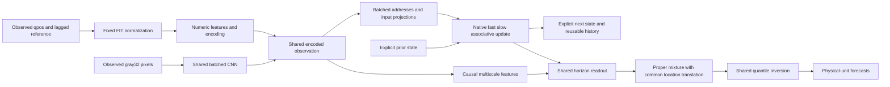

# ME091 — causal visual/native computational graph

This is a new capability-development candidate, not a claim of a new theorem,
visual superiority, autonomous control or completed intelligence. Source role,
pixel checksums and live count/optimizer checks must pass before fitting.

For an observed retained frame `t`, the only inputs are measured qpos `x_t`, the
previously recorded reference `a_(t-1)`, observed capture elapsed `dt_t`, and the
synchronized publisher overhead frame `I_t`. Future commands, images, capture
clocks, outcomes, episode IDs and task IDs are absent from the model inputs.
The publisher's retained-frame grid is distinct from capture wall-clock time.

## Input → parallel representations → native persistent state → forecast

`phi_t` contains current state/reference error, observed velocity/acceleration,
reference change, per-coordinate time since change, elapsed time, and causal
local innovation. Its 99 components use the frozen FIT-only normalizers.

```
v_t = tanh(W_img pool(CNN(gray32(I_t))) + b_img)
u_t = E(phi_t) + sigmoid(g_img) * v_t
```

All images and numeric features in a known prefix are encoded in a single
batch/time tensor operation. The three convolution stages share weights across
all frames (channels1→8→16→16; stride2). A2x2 pool preserves coarse spatial layout.
No pretrained image weights, reconstruction targets or future image teachers
are used. Gates and the visual representation are learned end to end.

The same `u_t` is reused by causal multiscale convolutions, associative address
projection and native fast/slow updates. Addresses/input projections are computed
once for the known prefix. With `r_t=15*dt_t`, the native associative path is

```
k_t = key_t / sqrt(sum(key_t²) + 1e-6)
D_t = exp(logsigmoid(retention_t) * r_t) * M_(t-1)
e_t = tanh(value_t) - D_t k_t
M_t = project_Frobenius_radius4(D_t + sigmoid(write_t) e_t k_tᵀ)
```

Fast and slow coordinates retain their bounded elapsed-time convex updates.
Their coupled nonlinear dependence requires sequential state evolution. This
architecture is **not an associative linear scan**; parallel image/projection
work does not make the entire recurrence parallel or eliminate O(T) total work.

The local convolution representation and native state representation are reused
across all horizons in one shared SwiGLU readout, width108 (previously116).
Horizon/coordinate outputs are batched. The reduction makes room for7792
new visual weights and1526 shared-location weights without dummy parameters:94907 retained original values +
9318 newly initialized visual/location values = **104225 active trainable/deployed values**.
The exact paired value/gate truncation is explicit in `load_initial()`.

The head yields one two-Laplace physical mixture per coordinate/horizon. Quiet
innovation is bounded by FIT noise, while posterior predictive scale is allowed
to exceed sensor quantization. Moving means retain the native bounded
velocity/reference/residual calculation. Median, intervals, likelihood and CRPS
all derive from this same mixture. These are conditional marginal forecasts,
not guaranteed mutually consistent sampled trajectories or chosen actions.

## Computation reuse and execution boundary

The functional state has the same13 tensors /1331 scalar cache values per
entity as the prior clock-value model: native fast/slow/association, previous
observed state, velocity, seen flag, reference, change age, encoded history/time,
raw-value history/time and clock. Images are encoded once per incoming frame;
only encoded history is retained. The caller owns entity isolation and actual
execution permission. Readouts do not overwrite observed-world state.

Full-prefix/chunk/step equivalence and prefix causality are numerical tests.
A real-FIT autograd/export census must independently show that every learned
tensor is active. Actual forecast quality, external original replay, and measured
fixed-profile execution remain separate evidence requirements. No all-shape,
whole-graph acceleration or predictive gate pass follows from compiler tests.

## Shared predictive-location translation

The shared head additionally produces14 zero-initialized location coefficients
per horizon. `d_h = FIT_delta_scale * h * tanh(location_h)` translates BOTH
Laplace component means. Component separation, probabilities and positive scales
remain unchanged. Every quantile and the median translate by exactly `d_h`;
likelihood and CRPS are still evaluated from the translated proper distribution.
This gives the integrated model a direct shared correction of predictive location
without another recurrence, a second model, future inputs or a nonprobabilistic
point override. It can also worsen predictions; unchanged full gates decide.
The104508-parameter no-fit draft is preserved separately; neither version was
trained or REPORT-scored before the prospective source/model registration.

Translation equivariance gives `Q_tau(p_shifted)=Q_tau(p)+d_h`, hence the exact
direct quantile derivative with respect to the location logit is
`FIT_delta_scale*h*(1-tanh(location_h)^2)`. This is an ordinary location-family
identity, not a new theorem. It provides a direct point/quantile gradient path
independent of which mixture component dominates. Empirical benefit still
requires the unchanged full forecast gates; the identity alone proves no skill.



`PhysicalVisualGraph` includes the frozen float32 observation/image preprocessing,
float64 normative model, quantiles, physical-unit conversion and all13normalized
state outputs in one pure tensor boundary. Fixed-profile derived executables
verify actual FIT inputs through this boundary. Pixel decoding/area resize,
storage/network, caller authority and cache hash/revision checks remain explicit
runtime effects outside the learned tensor graph, not hidden measured costs.
