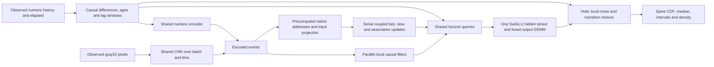

# ME093: a shared three-regime native predictive graph

Prospective architecture development on the same licensed real inputs as ME091/092.
Not an architectural winner claim. The complete predictive gate is unchanged.

## Compact architecture notation

Let $\chi_t$ encode the observed numeric features and image, $\ell_t$ be its
causal local-filter context, and $z_t=(f_t,s_t,M_t)$ the native learned state.
The remaining ten explicit state fields carry observed values, clocks and finite
filter buffers. With positive observed elapsed $\delta_t$, the core graph is

$$
\chi_{1:T}=E_\theta(\phi(x_{1:T},a_{0:T-1},\delta_{1:T}))
 +\operatorname{sigmoid}(g_I)\odot C_\theta(I_{1:T}),
\qquad z_t=F_\theta(z_{t-1},\chi_t,\delta_t).
$$

The first expression exposes independent batch/frame encoding; the second retains
its actual recurrent dependency. Shared conditional readout and distribution are

$$
u_{t,h}=G_\theta(\ell_t,z_t,c_t,\eta(h)),\qquad
p_\theta(y_{t+h}\mid H_t)=\sum_{j=0}^2w_{t,h,j}
\operatorname{Laplace}(y_{t+h};\mu_{t,h,j},b_{t,h,j}),
\qquad \hat y^{(\alpha)}_{t,h}=F^{-1}_{t,h}(\alpha).
$$

These are coordinate marginals conditioned on the same observed history, not a
joint future trajectory. The functional runtime consumes explicit state and emits
new state plus forecasts; a separate revision-bound entity cache handles reuse.

## Input-to-output contract

At recorded origin t, only observed qpos x[<=t], recorded reference a[<=t-1],
positive observed capture-time increments and aligned observed overhead pixels
enter the graph. FIT-only location/scale buffers normalize numeric float32 inputs;
uint8 gray32 pixels divide by255. Reference scoring then promotes these exact
values and original weights to float64. Retained frames are not wall-clock seconds.
No future image, command, human-takeover label, target or episode identity is an input.

For a batch of histories, the shared graph is:

The mathematical state is explicit: z_t=(f_t,s_t,M_t,previous,velocity,seen,
previous_reference,age,encoded_history,encoded_times,raw_history,raw_times,clock).
There are1331stored scalar state values/entity, independent of total stream length.
This does not establish reliable unlimited-memory prediction. Runtime cache keys,
input hashes, weights and output containers are additional storage.

Native coupled recurrence is unchanged, including bounded fast/slow updates and
normalized gated associative error correction. Encoded addresses and input
projections are computed for all observed frames once. CNN, feature preparation,
local filters and independent horizon heads expose batch/time/horizon parallelism.
The state-dependent native recurrence remains serial in time; it cannot honestly
be replaced with an associative affine scan without changing the model.

## Three probability regimes

Let h in{1,4,16}; d be the FIT predictive delta unit, n the FIT measurement-noise
unit, x the latest normalized observation and r the causal median of its last
three observed values. The shared hidden tensor produces dynamic logit u,
local-noise logit v, scale fields b0,b1,b2, blend c and the retained native dynamic
prediction D. Its1526dynamic-translation values are retained, not shared with
an observation-centered quiet component.

mu0=x; mu1=x+(1-sigmoid(c))*(r-x); mu2=D.

s0=max(1e-7,n*sqrt(h)*(.01+softplus(b0)))
s1=2*s0+sqrt(n*d)*sqrt(h)*(.01+softplus(b1))
s2=2*s1+d*h*(.01+softplus(b2)).

w=softmax(0,v,u), and p(y|history,h)=sum[j=0..2] wj Laplace(y;muj,sj).
Every component is normalized, positive-scale; weights sum toone. This is one
proper probability distribution, not an average of separately chosen forecasts.
The local-noise center is a convex combination of known observations. The learned
dynamic center preserves the parent ME092 dynamic mean at initialization.
Scale ordering separates regimes and makes all CRPS divided differences safe;
it is a modeling restriction, not a guarantee of calibration or narrow intervals.

For Laplace components, E|Xj-y|=|muj-y|+sj exp(-|muj-y|/sj).
For unequal scales b<c and separation d0, the independent cross-distance is
E|Xi-Xj|=d0+(c^3 exp(-d0/c)-b^3 exp(-d0/b))/(c^2-b^2).
Self-distance is1.5b. CRPS=sum wj E|Xj-y|-.5sum wij E|Xi-Xj|.
The implementation is tested against an independent numerical integral of
(F(z)-1[z>=y])^2, split at y to avoid a discontinuous quadrature endpoint.

All reported quantiles invert this same CDF. Forty reference bisection steps
start at min(mu-32s),max(mu+32s); Laplace tails there are <=.5exp(-32), safely
outside the scored .05/.5/.95 levels. Implicit median gradients use
-d_theta F(q)/p(q) at the detached root. Independent finite differences test means,
scales and logits. Proper scores alone do not prove calibrated finite-model fits.

## Training and reuse

96,595active learned values:82,699retained native,7,792retained visual,
1,526retained dynamic-location and4,578new local-noise values. Remove112old
lag-logit rows, retain99meaningful parent fields and add42local-noise rows;
no padding, frozen learned encoder or unused outputs. One hidden tensor and one
concatenated output GEMM serve every branch. Frozen compilation may fold the
parameter concatenation; eager training still has its real allocation cost.

All five indexed ME092parents, all values trainable;3,072new guarded AdamW updates
per model. Retained LR.0001/new rows.0003, wd.0001, clip1. One shared forward,
one batched VJP for quiet-H1/moving-H1/long proper-score sensitivities, deterministic
rotating PCGrad, one guarded optimizer step. No descent or gate guarantee.
Original weights/optimizer/RNG and all five receipts must enter Git before REPORT.

Native and visual retained values receive9,216updates along their own lineage,
dynamic location5,120,new fields3,072. Total charged pipeline13,312updates plus
all other preserved failed recipes. This is not matched-compute superiority.

## Scope and verification

Unit tests check budget, causal prefixes, chunk/step equality, scale ordering,
parent dynamic-mean preservation and distribution mathematics. Real FIT preflight
checks every parameter has a finite nonzero gradient and verifies task partition
against the independently assembled unsplit score under original1e-5/1e-6tolerances.
This numerical contract uses relative AND absolute tolerance; a maximum absolute
error above1e-6 can still pass relative tolerance and is reported explicitly.

Derived fixedB2T32/B2T1 executables will trace the entire input-to-quantile/state
function, including exact original preprocessing in the physical wrapper. Tests
on different actual FIT inputs and an independent clean restore are compulsory.
Compilation speed at one fixed shape/shared CPU is not a general latency claim.
No video/network decode, authorization or authoritative state mutation is inside
this learned tensor graph. No autonomous policy or customer-value claim.

## Computational reuse rules

A functional event operator is (forecast_t,z_t)=F_theta(z_(t-1),event_t), with
explicit model/preprocessing revisions. Reuse requires equality of the entity,
contiguous event index, exact numeric/capture inputs, image content hash and model
revision. The existing VisualValueCache supports the new distribution without
changing its mathematical fields: exact retries return cloned forecasts, changed
inputs reject reuse, entities retain isolated state, ordinary parameter/buffer
mutation invalidates cached state. Corrected history requires explicit reset and
verified replay; no silent stale prediction.

Training does not memoize learned encoder activations across optimizer updates:
those would become stale as theta changes. Reuse within the one shared forward
is valid; the3task VJP shares that computational graph. Fixed source pixel decoding
is reusable because it has no learned weights. Quantile inversion computes mixture
weights once before its40iterations and vectorizes independent coordinates,
horizons, query levels and batch items. The bisection iterations themselves remain
ordered and are not described as a parallel scan.

For fixed widths and horizon count, native inference work and stored tensor state
per new event are O(1) in total past stream length. Full Tframe prefill/training
work is O(T), with a serial native-state critical path of lengthT; batching and
compilation reduce overhead but do not erase that dependency. A Transformer KV
cache instead stores O(Td) values and typically needs O(Td) attention work for a
new query; caching does not make all attention or generation linear-cost overall.
Hardware fusion/CSE are measured on actual exported graphs, never inferred simply
from the phrase 'tensor DAG'. No claim that all operations stay in SRAM/registers.

## Native state equations and computation types

For elapsed ratio rho=15*observed_elapsed>0, the input projection yields a
normalized key k, value v, retention logit l and write logit b. Let
D=exp(logsigmoid(l)*rho)M and r=Dk. With shared learned affine maps producing
candidate c and gate g, fast state is
f'=lerp(f,tanh(c),1-exp(logsigmoid(-g)*rho)).
The slow map of[f'-s;s] yields innovation j and rate a; then
s'=lerp(s,tanh(s+tanh(j)),1-exp(logsigmoid(-a)*rho)).
The associative correction is M*=D+sigmoid(b)(tanh(v)-r)k^T,
followed by radial projection M'=M*/max(1,||M*||F/4).
Representation=W[f';s';r]+bias. The read r is from decayed pre-write memory,
exactly as in the inherited implementation; this document does not silently move
that read or claim independent retrieval superiority. Keys use denominator
sqrt(sum(k_raw^2)+1e-6); normalization stabilizes scale, not semantic alignment.

From bounded initialization, f/s remain within[-1,1] by convex updates and
||M||F<=4 by projection. These are numerical state bounds, not useful-memory or
forecast-accuracy theorems. Positive observed elapsed is compulsory.

Computation families actually present: spatial convolutional perception; causal
differences/elapsed integration; parallel local temporal filtering; conditional
nonlinear recurrence; rank-one associative error correction and matrix retrieval;
gated nonlinear horizon queries; probabilistic mixture density and quantile root
solving; shared-graph reverse differentiation and gradient conflict projection.
Absent here: natural language generation, symbolic proof/search, autonomous action
selection, causal intervention identification or certified long-horizon planning.
The horizon distributions are direct marginal forecasts, not a sampled coherent
joint future trajectory or a closed-loop physical simulator.

The actual restored fixed-profile graph also proves final-only elimination: the
64x72native representation projection constant has one linear consumer in both
32frame prefill and1frame step graphs. Intermediate representation projections
do not feed future state and are pruned; all necessary state updates remain.
Dense-prefix training still needs all prefix representations. Restored graph
canonicalization changes node counts relative to pre-save frozen graphs, so those
counts must not be interpreted as saved arithmetic or compared interchangeably.
