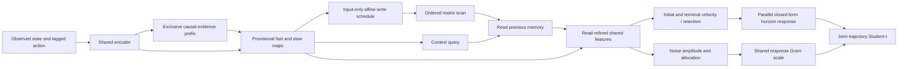

# ME098 — a mathematically composed trajectory distribution

**Candidate in the existing shared six-family engine; physical lane only.**
One future-conditioning pass, stable forecast algebra, coherent uncertainty.
Parent ME097 remains immutable. Original source/checkpoints/failures are preserved.
Read master plan3bfd9779 and Capability Progress Truth Standard before design.

## Capability objective and ideas selected

ME097 predicts only the next recorded state. Its best evidence is exposed-DEV,
not independent transfer. Extend the complete model to forecast1/4/16real frames
and return one joint probability distribution for those future outcomes, while
preserving the existing one-step skill. Do not spend another cycle only changing
retention. The parent95,874weights remain trainable;7,448newweights parameterize
one structured forecast head (total103,322). No dummy/frozen-encoder budget bypass.

This study implements the first of four priorities:

1. **Composed future trajectories:** one conditioned dynamical law and shared
   noise, replacing inconsistent independent horizon heads. Implemented here.
2. **Observed-time and missingness-aware evidence:** future work requires
   source-supported irregular observation times and observation-mask contracts;
   finite valid-padding support is not proof of recovering missing evidence.
3. **Task-relevant writes and retrieval:** use proper future prediction as the
   reason to admit/retrieve evidence; retained matrix survival alone is inadequate.
   This model trains the existing integrated retrieval path, without attribution.
4. **Deeper structured blocks and hardware implementation:** after useful skills,
   compare task-conditioned block stacks, chunkwise kernels and hardware tiling.
   Every layer's schedules must be known before its own scan; no claim that an
   arbitrary nonlinear feedback loop becomes associative. No such stack/GPU win
   is implemented or asserted here.

## Typed graph and explicit dependencies

Inputs: x[B,T,14]normalized recorded observation, a[B,T,14]PREVIOUS-frame
recorded action, bool valid[B,T], and optional same-entity EvidenceState.
Exactly the original fast/slow/8x8input-scheduled core; no future actions or labels.
Core conditioning is evaluated ONCE and can be reused for multiple horizon sets.

State remains88prefix scalars+64memory scalars+one int64count per entity:608FP32
bytes+8countbytes, excluding model/activations. Basis sum can grow indefinitely;
fixed size is not unlimited reliable retention or floating stability proof.
Temporary imagined velocity is **not** stored into the observed-world evidence.

The new implementation version exposes the shared decoder features directly;
archived `evidence_retrieval_world.py` is unchanged, preserving original hashes.
No hooks/side effects/intermediate mutable cache are used. Six-family factory
selects the same candidate by configuration; five other domain heads stay OPEN.

## Exact forecast law (one coordinate)

For a fixed conditioning, head emits v0, terminal velocity u, retention r and
positive noise parameters. The future latent law is

    x[k+1] = x[k] + v[k] + sx epsilon[k]
    v[k+1] = r v[k] + (1-r)u + sv eta[k]

0.01<r<0.99 via a bounded sigmoid. v0 retains the parent's bounded learned
one-step correction; u=delta_scale*tanh(newhead). All rates/velocities are
conditioned on observed past only and held FIXED during one forecast query.
Units are training-standardized state per RECORDED FRAME, not inferred SI units
or exact physical seconds. Current data cadence does not qualify continuous-time
or irregular-time forecasting. Future recorded timestamps are not model inputs.

Define g_h(r)=sum_{j=0}^{h-1}r^j. Then

    mean_x(h)=x0+g_h v0+(h-g_h)u
    mean_v(h)=u+r^h(v0-u).

This is a closed-form mean of the same law at every horizon. g_0=0 and g_1=1,
so h0returns exactly x0 and h1preserves the old point path at initialization.
Bounded v0,u and0<=r<=1 imply each future mean velocity remains within their
coordinate bounds and |mean_x(h)-x0|<=h*delta_scale. The forecast does not promise
bounded physical positions as h grows or safe control. Stable latent velocity
does not prove global neural gradient stability or useful long-memory.

The exact identities g_(m+n)=g_m+r^m*g_n and F_n(F_m(s))=F_(m+n)(s)
hold for FIXED r,u and evolved mean velocity. Reconditioning on new observations
can change r,u; composing across changed conditionings is not this theorem.
No claim that restarting the API with mean alone preserves stochastic covariance.

## One coherent uncertainty distribution

Let future position innovations have response W(h,j)=1[j<h], and future
velocity innovations K(h,j)=g_max(h-1-j,0)(r). Define the shared scale matrix

    S(h,l)=sx^2 sum_j W(h,j)W(l,j)+sv^2 sum_j K(h,j)K(l,j).

It is a sum of response Grams, positive semidefinite by construction. Distinct
positive requested horizons make W full row-rank; sx>0 makes S positive definite
in exact arithmetic. Zero horizon gives a degenerate exact anchor; density at
zero/invalid rows is not scored. Repeated horizons are rejected. Selection of a
horizon subset preserves its marginal mean/scale; no contradictory independent
per-horizon location/noise heads are fitted. Output covariance couples horizons;
residual channels are conditionally independent, an explicit modeling limitation.

One shared inverse-gamma scale per coordinate/forecast yields a df4 multivariate
Student-t trajectory. Marginal90%interval uses t4(.95)=2.1318467863sqrt(S_hh).
Student-t S is a SCALE matrix, not variance: actual covariance=2S for df4.
Heavy tails retain unbounded support; no arbitrary max-hours clipping or claimed
coverage guarantee. Full cross-channel, action-counterfactual and policy models
remain OPEN. No conformal calibration or DEV temperature fitting is performed.

Noise head uses amplitude=delta_scale*(.02+softplus(raw)), allocation
p=.05+.90sigmoid(raw_share), sx=amplitude*sqrt(p), sv=amplitude*sqrt(1-p).
This keeps variance allocation away from singular extremes without an arbitrary
upper cap on uncertainty. Sigma values are learned by proper likelihood.

## Precision, complexity and proofs

Compute g using expm1(n*log(r))/expm1(log(r)); bounded r avoids division near1.
Mean uses g*v0+(h-g)*u to avoid cancellation and preserve the one-step anchor.
NN/history/mean retain original dtype; response Gram accumulation and joint
Cholesky/log-density use FP64. No adaptive jitter or silent covariance repair.
The finite-precision NN equivalence limits are fixed at rtol1e-5/atol1e-6 FP32,
rtol1e-8/atol1e-10 FP64. Raw forecasts and score replay use1e-5/1e-6.

Observed-history memory scan keeps O(T)fixed8x8matrix work/O(logT)depth;
encoder/proposals/queries/readout are batched across time and entities. Forecast
queries use Hrequested horizons and J=maxh noise-response slots, with O(DH^2J)
Gram work, O(DHJ)temporary response storage, and **zero sequential future neural
passes**. This is mathematical work/depth accounting, not measured GPU throughput.
A single covariance-aware trajectory is not arbitrary parallel reasoning.

PNDS provides Lean exact-real finite-gain composition, mean-flow semigroup and
response-Gram nonnegative quadratic forms; Python independently executes
chronological native memory plus future state/noise sensitivities. Actual source
values/state/input and parameter gradients are compared. Full concrete neural
Lean refinement, strict finite-precision SPD bounds and global probabilistic
calibration remain OPEN. No toy theorem is called whole-network verification.

## Prior art used; no novelty-by-renaming

Mamba-2 (Dao/Gu,ICML2024, https://proceedings.mlr.press/v235/dao24a.html),
Sections3and5: structured operator representations and block decompositions make
parallel/recurrent duality explicit. Gated Delta Networks (ICLR2025,
https://arxiv.org/abs/2412.06464), Sections2–3: read/write algebra, gated delta
updates and chunkwise training are established. The papers were read for their
operator assumptions, not treated as performance guarantees for TAC. Linear
state-space prediction and Student-t Gaussian scale mixtures are established
probability constructions, not new discoveries. This is a capability-driven TAC
integration hypothesis; no SSM/Mamba-equivalence or architectural novelty claim.

## Registered real-data protocol and decision

Source/publisher checksum/license exactly ME097;59FITepisodes,13exposedDEV,
last15%not scored. Only genuinely consecutive real records. History64, targets
1/4/16frames for every observed prefix. Source index windows may shift to make
all factual future targets available; old ME097 is rescored on EXACT new cases
for H1guardrail. Previous model has no H4/H16head, so do not invent a before/after
comparison at those horizons. No untouched cohort opened or new-site claim.

Five new originals98001–98005, corresponding fixed ME097parent97001–5. All old
weights trainable;512newupdates/batch8; retainedLR.0001/newheadLR.0006,AdamWwd.001,
clip1; no sweep/retry. Total lineage768updates, not512cold-start updates. Loss
weights .6/.2/.2 FIT-RMS-normalized MSE +.05proper joint tNLL/3. FIT statistics
only, no DEV-calibration tuning. All originals/optimizer/RNG/source/schedules
committed BEFORE scoring, with byte-enforced freeze, pre/postlive budget audits,
study-named pre/postaudit workflow and independent clean-checkout replay.

EVERY seed: each horizon MSE<=.95persistence; H1MSE<=1.05parent on samecases;
90%coordinate coverage>=.85 eachh; intervalscore<=1.05FIT-moment-t reference.
All criteria frozen prefit. Outcome can fail; do not change gates after scoring.
All per-episode/horizon raw errors and regressions remain. One architecture
capability study, not matched-capacity/data/compute architecture competition.

## Capability-to-value card

Skill: jointly predict several real future states with a coherent time-uncertainty
structure and retained one-step ability. Task/operator: read-only short-horizon
physical monitoring; no real decision reward/cost supplied. Original data and
prediction cutoffs above; source units not independently certified SI. Customer,
commercial pilot, Woyengi deployment, action utility and ROI NOT_MEASURED.
Stage unlocked only if trained/replayed factual capability is observed. No merge,
control execution, autonomous policy or product-readiness claim.
