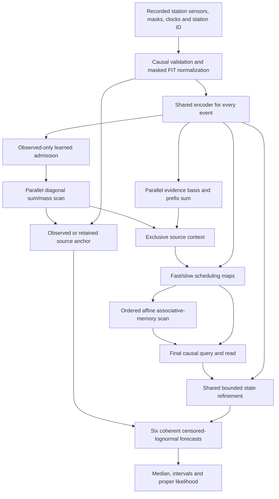

# Input-to-output execution graph

The two prefix computations can run alongside each other, then schedule the matrix scan. Their order is a dependency, not a claimed single universal scan. The last query and decoder run once per requested forecast, reusing the encoded observations and final states. Streaming uses the same equations with explicit owner/clock/version state. No fixed wall-clock speedup is inferred from this graph.
