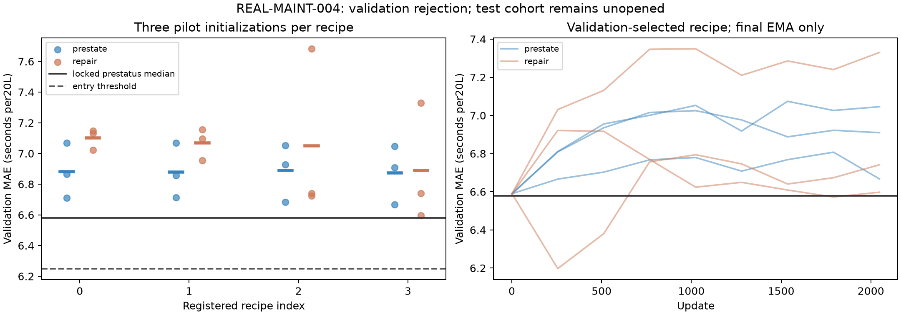

# REAL-MAINT-004 — real repair records; neural candidate rejected

The recorded replacement-bundle predictor did not beat a simple pre-intervention
status reference. **No model promotion, no test opening and no20fresh-seed claim.**
This is real factual-outcome training, not a commercially validated repair agent.

## Recorded result

Twenty-four registered pilot fits completed: two neural arms ×four recipes ×three
initializations, each2,048updates, final EMA only. All pilot/collection processing
used41.64CPUseconds. The selected recipe for each arm was LR.003/weightdecay.01.

| Validation predictor | MAE, seconds per20L |
|---|---:|
| Train median | 6.5893 |
| Train prestatus-conditioned median, locked reference | 6.5788 |
| Ridge alpha.1 | 11.9095 |
| Ridge alpha1 | 9.0913 |
| Ridge alpha10 | 8.1437 |
| Selected prestate neural recipe, mean of3pilots | 6.8742 |
| Selected repair-bundle neural recipe, mean of3pilots | 6.8898 |

The repair recipe is approximately4.73% WORSE than the reference; registration
required at least5% improvement (MAE<=6.2498seconds). Its three pilot errors were
6.7414/7.3304/6.5977seconds. Recipe selection used their mean, not the lucky seed.
No fresh matrix was fitted; the60rows/39name-groups in the later test assignment
remain unparsed as targets. Their number of valid outcomes is therefore unknown.

The small prestate MLP has5features/385parameters; the repair MLP has173encoded
features/3,073parameters. This does not isolate architectural necessity or imply
that replacement information is universally useless. It rejects this registered
predictor/recipe on this survey and split. CASM/CDL are not tested here.

## Data and information boundary

Publisher: openwashdata floodchlorinationsurvey, real2019–2020 rehabilitation
records from Mulanje, Malawi, CC BY4.0, DOI10.5281/zenodo.15846578. Source commit
a2755213c841fdfc7b65aaaff0b91016296f2985; exact CSV SHA256 is in the protocol.

The split is fixed by normalized waterpoint group and REPORTED rehabilitation
date. Training:180assigned rows/129groups,178positive finite targets. Validation:
70rows/45groups, all70valid. Two malformed/nonpositive training targets are
excluded by the registered rule, with row IDs retained. Spanning groups and all
names appearing in the first10source rows are excluded. No residual trimming,
outlier clipping, outcome imputation or feature/target-based resplit.

Inputs contain only explicitly pre-intervention functionality and recorded
replacement/chlorination fields. Names, dates, coordinates, photos, comments,
ratings of ambiguous timing, after-functionality, stroke counts and actual bucket
time never enter inference. Unknown replacements remain explicitly missing.
Vocabulary, numerical imputation and scaling are training-only. Numeric output
is **SECONDS PER20L**, directly checked against the publisher dictionary.

## Engineering checks and artifacts

- Full prefit regression:1,489tests pass. The initial incomplete sparse-fixture
  checkout failures are preserved; original fixtures were restored without
  weakening tests.
- All24final checkpoints replay1,680validation predictions. The2,054compared
  numeric values match exactly locally; all48raw/final checkpoint files remain.
- Two standalone diagnostic exports reproduce10forecasts with NumPy, TAC-OSM
  and Veritas imports forbidden. Metadata identifies the first registered
  recipe0/seed97400 pilots, not best seeds or promoted candidates.
- Source and archive hashes, fit curves, conventional references, split IDs,
  anonymous group hashes, technical prepared inputs/targets and failed entry
  decision are retained. No held-out target is serialized.

## Limits and next decision

No actual prices, inspection charges, independent collector/follow-up timing or
complete action authorization contract exists here. Reported replacement actions
are not randomized, complete hypothetical plans; this model cannot identify
causal repair benefit. Repeated names are imperfect asset identifiers; grouping
may merge distinct assets. Outcome-validity exclusions and same-survey sampling
further limit scope. A bucket-fill proxy does not certify water quality or
industrial equipment restoration.

Do not tune another recipe against these same validation outcomes and call it an
independent success. Preserve the later test cohort. The positive REAL003 room
forecaster stays a separate component; it does not solve this repair task. The
broader learned-maintenance goal remains ACTIVE and not commercially qualified.
